# Notch

**Dynamic Island لويندوز** — شريط صغير شفاف أعلى الشاشة، بيوريك اللي شغال دلوقتي ويديك تحكم سريع من غير ما تفتح حاجة.

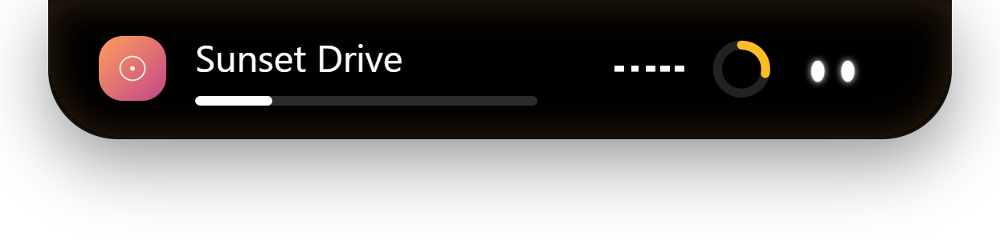

---

## تنزيل البرنامج

1. روح لـ [Releases](../../releases/latest) وحمّل أحدث نسخة من `Notch-Setup-x.x.x.exe`.
2. شغّل الملف. ويندوز هيورّيك تحذير "Windows protected your PC" لأن البرنامج مش موقّع بشهادة رسمية — ده طبيعي لبرنامج مستقل، دوس **More info** ثم **Run anyway**.
3. التثبيت تلقائي بالكامل (One-click) — هيتسطب ويشتغل لوحده.
4. أي تحديث جديد هينزل ويتركّب **تلقائيًا** من غير ما تعمل أي حاجة: هيظهر احتفال صغير (كونفيتي) يقولك "Updated" ورقم النسخة أول ما يفتح بعد التحديث.

> البرنامج مش موقّع بشهادة (Code Signing) لسه، فده سبب تحذير ويندوز. ده مش فيروس ولا حاجة خطيرة — الكود كله مفتوح للمراجعة هنا.

---

## الشاشة الرئيسية

كل حاجة من مكان واحد: الموسيقى، المؤقت، الصوت، الواي فاي، البلوتوث، الإشعارات، والرف.

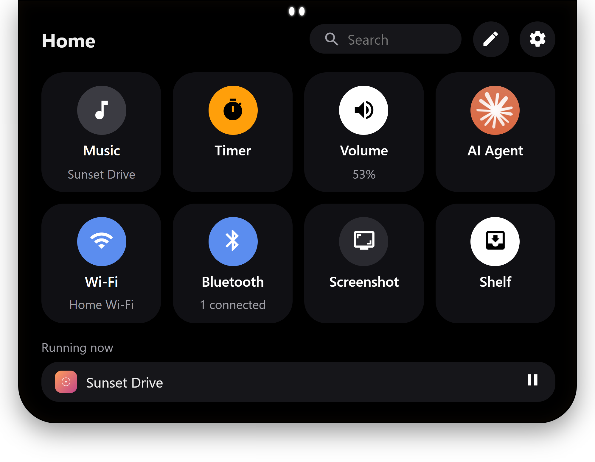

---

## الموسيقى

بيقرا اسم الأغنية والفنان والغلاف تلقائيًا من أي برنامج بيشغّل صوت (Spotify, YouTube Music, أي متصفح...)، مع تحكم كامل: تشغيل/إيقاف، تقديم/ترجيع، الصوت، Shuffle وRepeat.

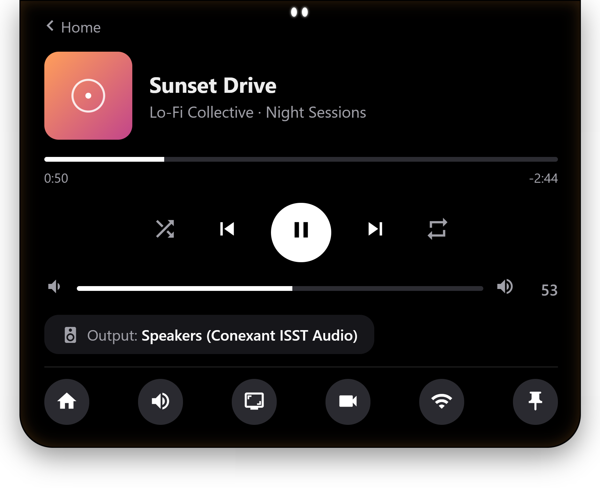

اضغط على غلاف الأغنية يكبر ويملا الجزيرة.

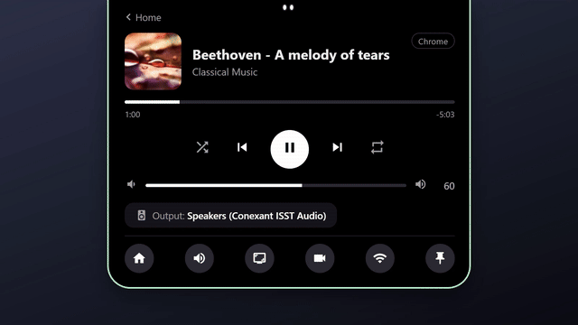

---

## المؤقت

مؤقت تركيز بسيط بحلقة بتعد تنازليًا، مع Pause وCancel وزيادة دقيقة.

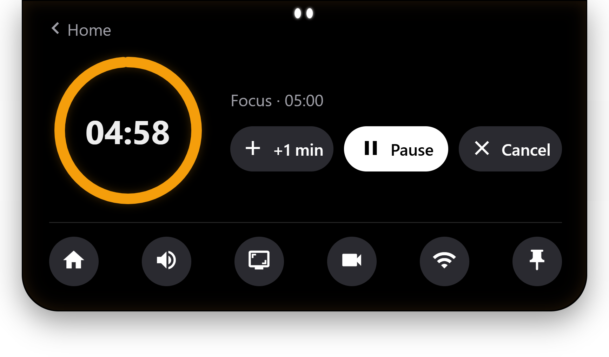

---

## التحكم في الصوت

مستوى الصوت العام، وبرنامج برنامج (لو أكتر من برنامج بيشغّل صوت في نفس الوقت).

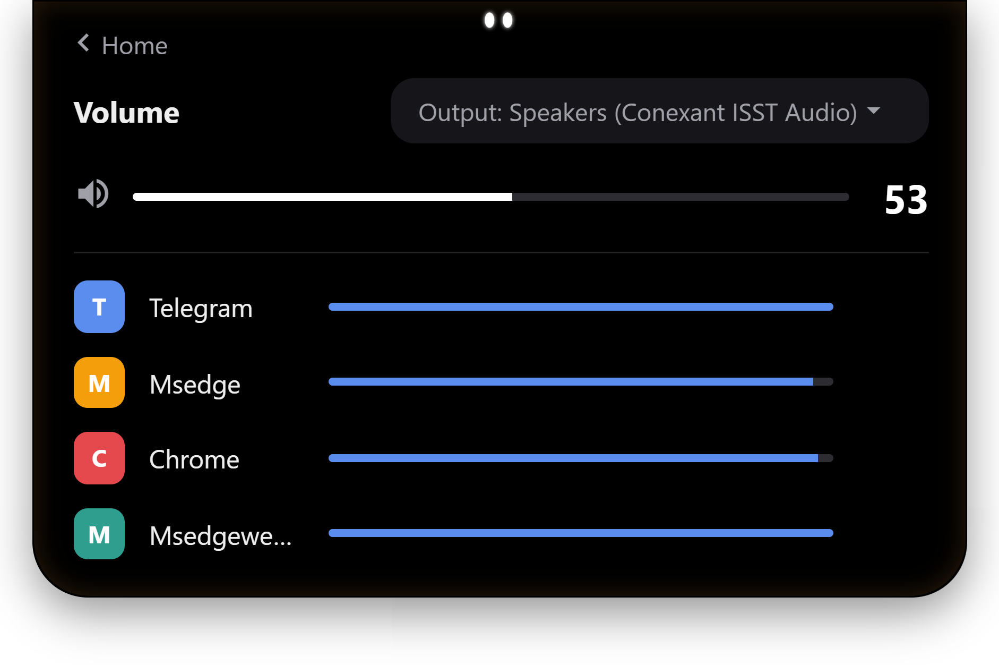

## الواي فاي والبلوتوث

تشغيل/إقفال، اتصال وفصل، ونسيان الشبكة — كل ده من غير ما تفتح إعدادات ويندوز.

  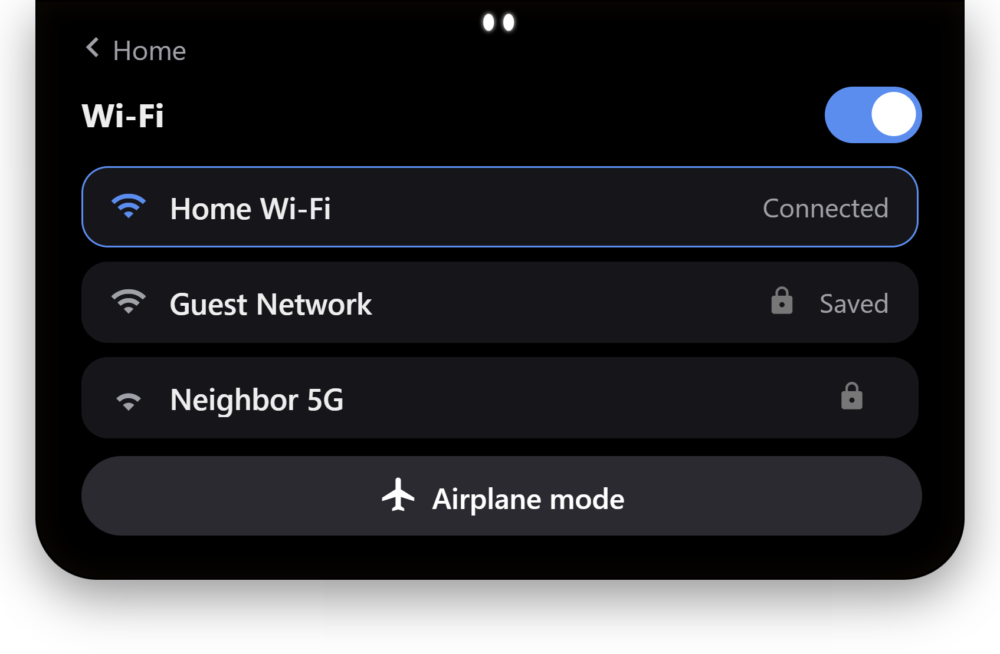
  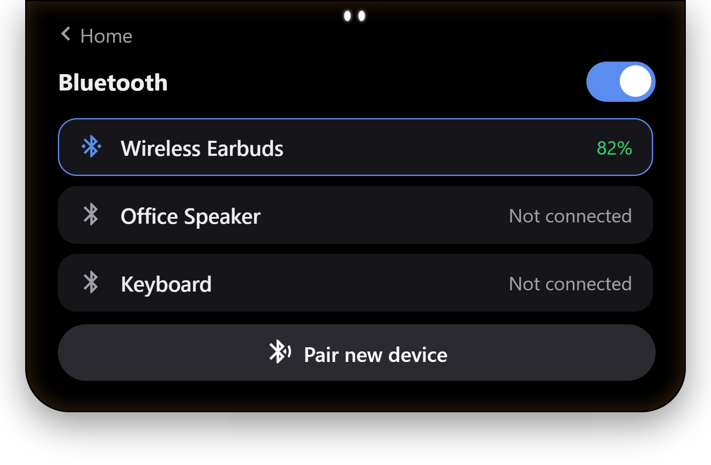

## الإشعارات والرف

كل الإشعارات (من وكلاء الذكاء الاصطناعي، التنزيلات، وغيرها) في مكان واحد مجمّعة. والرف مكان تسيب فيه ملفات مؤقتًا وتسحبها لأي برنامج أو مجلد.

  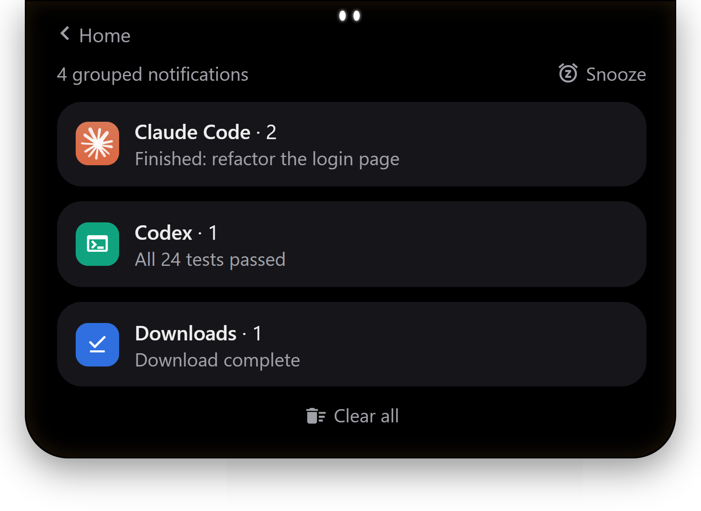
  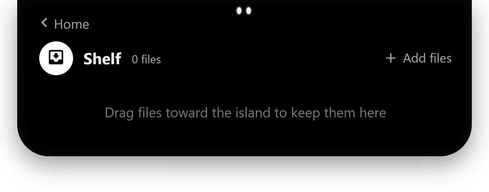

---

## لما المايك أو الكاميرا تشتغل

إشعار سريع (ثانيتين) بلون المايك (برتقالي) أو الكاميرا (أخضر)، وبعدها نقطة ثابتة بنفس اللون — جنب العينين لو مفيش حاجة تانية شغالة، أو جوه حلقة الاستخدام لو فيه حاجة شغالة فعلاً.

  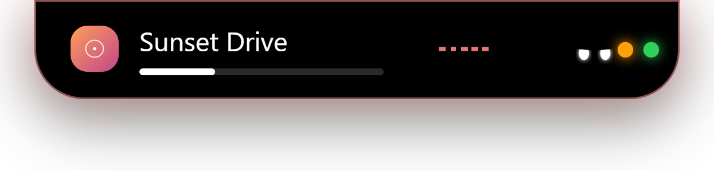
  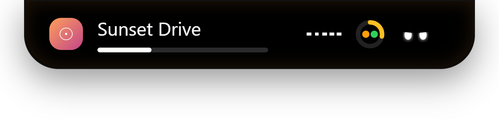

---

## بطارية بتتشحن، وتنبيه لما تخلص عملية

أيقونة بطارية بتتملي بدل برق لما توصّل الشاحن، واحتفال صغير (كونفيتي) وصوت مميز لما عملية طويلة تخلص.

  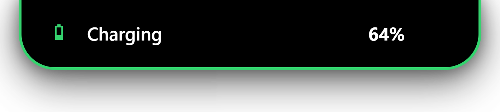
  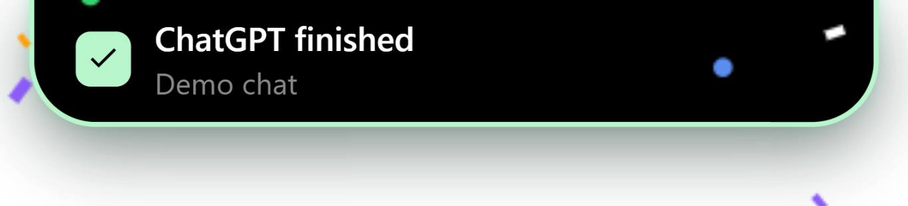

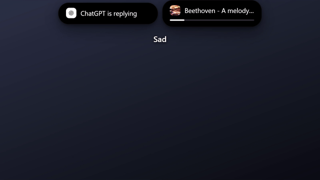

---

## كليك يمين = خط رفيع

عايز الجزيرة تختفي من غير ما تقفلها؟ كليك يمين عليها وتتحول لخط رفيع تحت أعلى الشاشة، وأي حركة ماوس فوقه بترجّعها زي ما كانت.

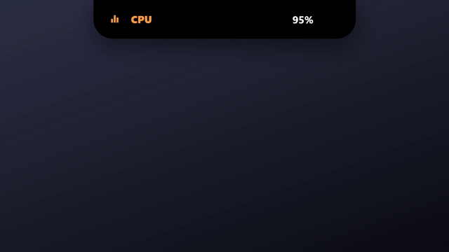

---

## إعدادات شاملة

تحكم كامل في شكل الجزيرة، الأصوات، اللغة، وتفعيل/تعطيل أي نشاط (تنبيهات الـ CPU والـ RAM، نقطة المايك/الكاميرا، سجل الحافظة، التنزيلات...) حسب ما يريحك.

  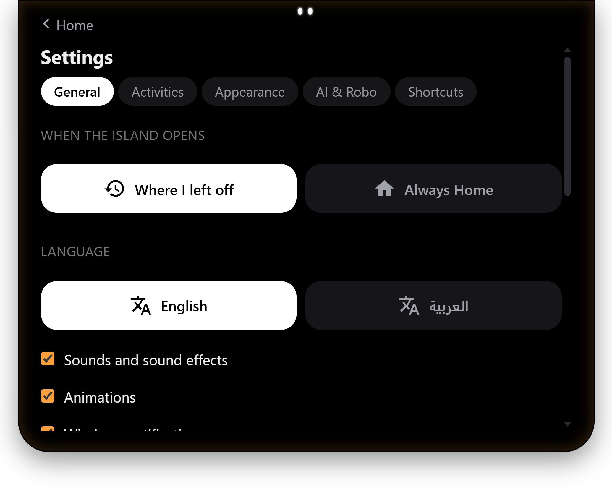
  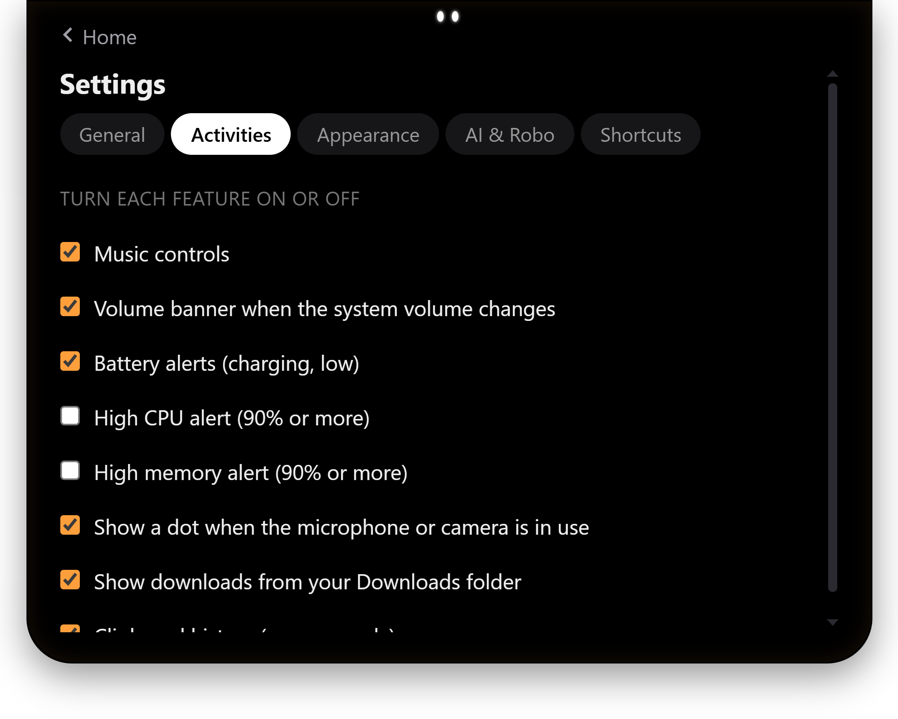

### اللغة العربية بالكامل

غيّر اللغة من الإعدادات، والواجهة كلها بتتحول RTL فورًا بخط **Teshrin**.

  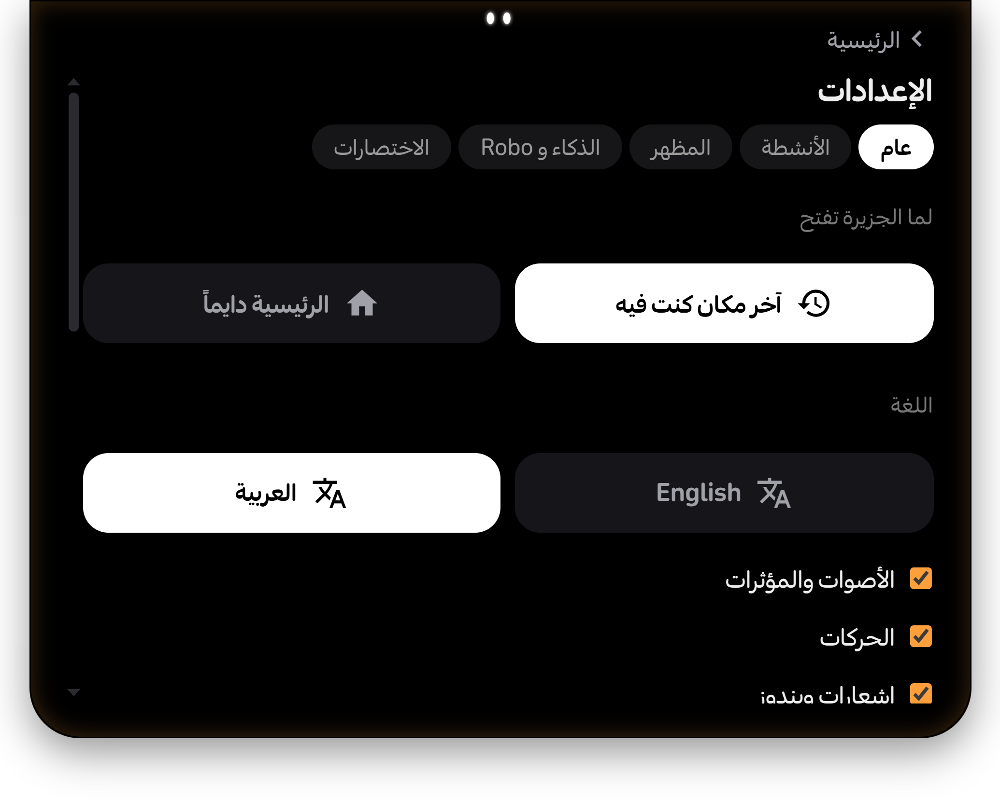
  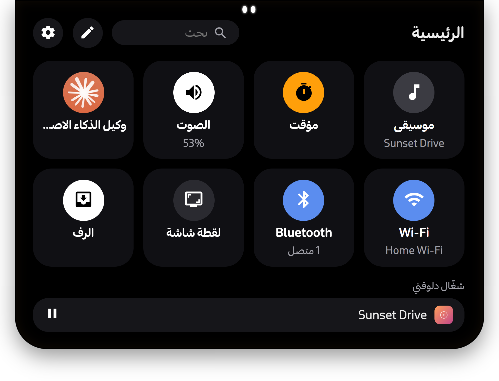

---

## إضافة المتصفح

تقدر تثبّت إضافة Chrome/Edge من جوه نفس التطبيق (Settings → General → Install the browser extension)، بتخلي نوتش يعرف لما ChatGPT أو Claude أو Gemini يخلصوا الرد، وتجيب احتفال خاص بيهم.

---

## اختصارات لوحة المفاتيح

| الاختصار | الوظيفة |
|---|---|
| `Ctrl+Alt+T` | فتح / قفل الجزيرة |
| `Ctrl+Alt+H` أو `Win+Alt+I` | الرئيسية |
| `Ctrl+Alt+1` | الرئيسية |
| `Ctrl+Alt+2` | الإشعارات |
| `Ctrl+Alt+3` | الموسيقى |
| `Ctrl+Alt+4` | ضبط المؤقت |

---

## الخصوصية

نوتش بيشتغل بالكامل على جهازك — كل البيانات (الواي فاي، البلوتوث، الموسيقى، الإشعارات) بتتقرا محليًا من نظام التشغيل ومتتبعتش لأي سيرفر خارجي. إضافة المتصفح بتتكلم بس مع نوتش على نفس الجهاز، من خلال توكن سري يتولّد تلقائيًا لكل جهاز.

---

## متطلبات التشغيل

ويندوز 10 أو 11 (64-bit).
