# Notch

**Dynamic Island لويندوز** — شريط صغير شفاف أعلى الشاشة، بيوريك اللي شغال دلوقتي ويديك تحكم سريع من غير ما تفتح حاجة.

---

## الجديد في 1.0.19

- **حركة سلسة**: الغلاف بيطير من مكانه لمكانه الجديد، والشاشات بتتبدّل بدون وقفة، والنصوص بتنزلق، والأرقام بتعدّ، والشريط لما يوصل 100% بيتحوّل لعلامة ✓. [التفاصيل](#حركات-سلسة)
- **أكتر من مهمة مع بعض**: الكبسولة بتنفصل لقطرات وبترجع تدوب في بعض، ودايرة حد الـ 5 ساعات بتاخد مكانها في الصف. [التفاصيل](#أكتر-من-مهمة-مع-بعض)
- **ضبط التايمر على مسطرة** لحد ساعتين، بصوت تروس. [التفاصيل](#ضبط-التايمر-مسطرة-لحد-ساعتين)
- **تنبيهات البطارية** بشكل جديد: أحمر لما تقل، وأخضر لما تتشحن أو تكمل. [التفاصيل](#بطارية-بتتشحن-وتنبيه-لما-تخلص-عملية)
- **الموسيقى**: أزرار أكبر، وأيقونة جديدة لما مفيش غلاف، واضغط على اسم الأغنية يفتحلك برنامجها (أو التاب بتاعها في المتصفح). [التفاصيل](#الموسيقى)
- اضغط على أي نشاط في القائمة أو الرئيسية يفتحلك الكارد بتاعه على طول.

---

## تنزيل البرنامج

1. روح لـ [Releases](../../releases/latest) وحمّل أحدث نسخة من `Notch-Setup-x.x.x.exe`.
2. شغّل الملف. ويندوز هيورّيك تحذير "Windows protected your PC" لأن البرنامج مش موقّع بشهادة رسمية — ده طبيعي لبرنامج مستقل، دوس **More info** ثم **Run anyway**.
3. التثبيت تلقائي بالكامل (One-click) — هيتسطب ويشتغل لوحده.
4. أي تحديث جديد هينزل ويتركّب **تلقائيًا** من غير ما تعمل أي حاجة (تفاصيل تحت في [التحديث التلقائي](#التحديث-التلقائي)).

> تحذير ويندوز سببه إن البرنامج مش موقّع بشهادة (Code Signing) لسه، مش أكتر. التحديثات اللي بينزّلها نوتش لنفسه موقّعة رقميًا، وبيتأكد من التوقيع قبل ما يركّب أي حاجة.

---

## الشاشة الرئيسية

كل حاجة من مكان واحد: الموسيقى، المؤقت، الصوت، الواي فاي، البلوتوث، الإشعارات، والرف.

---

## الموسيقى

بيقرا اسم الأغنية والفنان والغلاف تلقائيًا من أي برنامج بيشغّل صوت (Spotify, YouTube Music, أي متصفح...)، مع تحكم كامل: تشغيل/إيقاف، تقديم/ترجيع، الصوت، Shuffle وRepeat.

اضغط على غلاف الأغنية يكبر ويملا الجزيرة.

### أزرار أوضح، وأيقونة لما مفيش غلاف

أزرار التحكم بقت أكبر وأسمك (السابق والتالي أسهم ممتلئة وزرار الإيقاف أبيض كبير)، والـ Shuffle والـ Repeat فضلوا صغيرين وهادئين. ولو الأغنية من غير غلاف بتظهر أيقونة الموسيقى بتاعتنا: مربع أسود ونوتة حمرا، في الكارد وفي الـ pills وفي الرئيسية.

  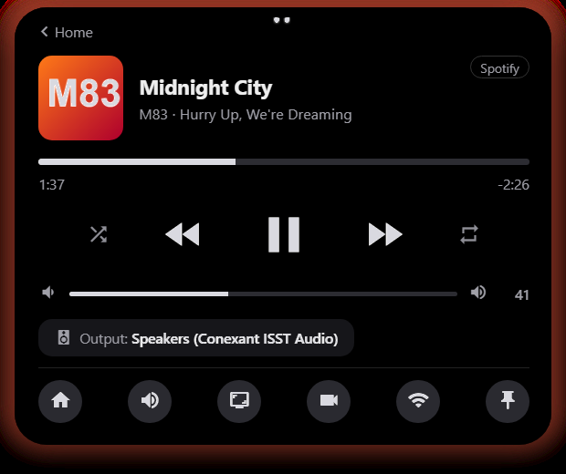
  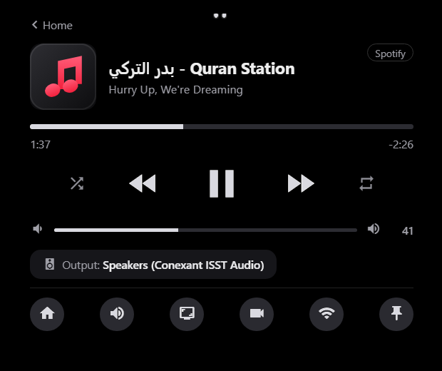

**اضغط على اسم الأغنية** يجيبلك البرنامج اللي بيشغّلها قدّام. ولو الأغنية في متصفح (Chrome أو Edge أو Brave...) بيفتحلك **التاب نفسه** حتى لو هو مش التاب الظاهر.

---

## حركات سلسة

الجزيرة بقت أقرب لحاجة حيّة: كل عنصر بيحافظ على هويته وهو بينتقل، مش بيختفي ويظهر في مكان تاني.

- **الغلاف بيطير**: من الأيقونة الصغيرة لحجمه في الكارد، ومن الكارد للصورة الكبيرة.
- **الدخول والخروج مع بعض**: الشاشة القديمة بتتلاشى وهي طالعة والجديدة بتدخل في نفس اللحظة.
- **النصوص بتنزلق**: اسم الأغنية القديم يطلع والجديد يدخل من تحت.
- **الأرقام بتعدّ** (46 ثم 47 ثم 48...) والشريط بيكبر معاها، ولما يوصل 100% بيتحوّل لدايرة خضرا فيها علامة ✓.

  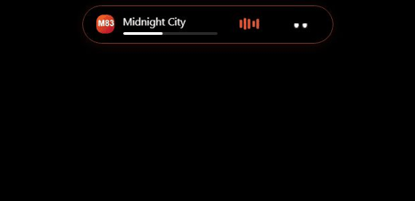
  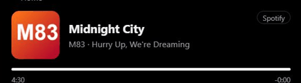

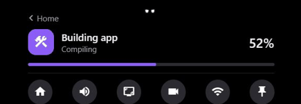

كل الحركات بتحترم إعداد **Animations** في الإعدادات: لو طفيته كل حاجة بتتغيّر فورًا.

---

## المؤقت وساعة الإيقاف (Stopwatch) — في مكان واحد

التايمر والستوب ووتش في نفس الكارد، وفوق تابين بتبدّل بينهم بضغطة. التايمر برتقالي والستوب ووتش بنفسجي.

  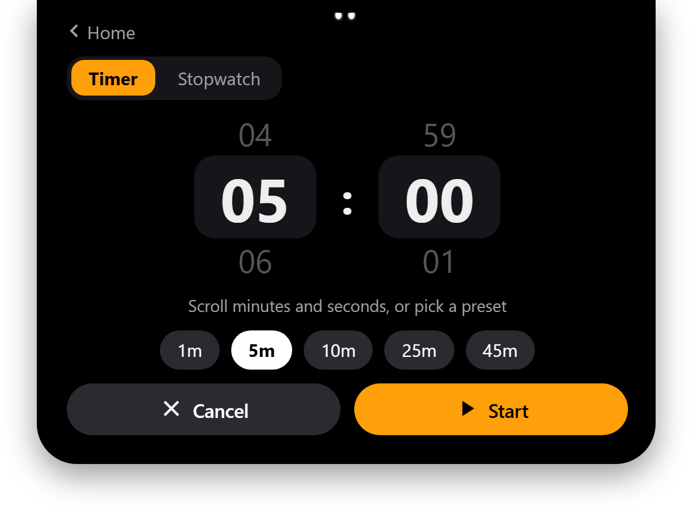
  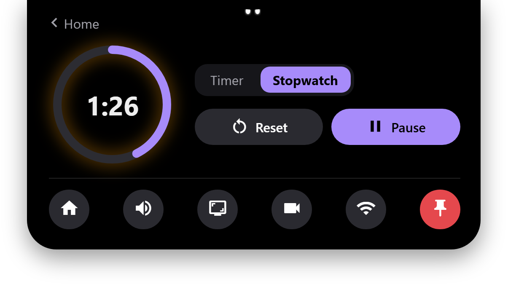

لما تقفل الجزيرة، الاتنين بيظهروا بنفس الشكل: أيقونة ساعة بتلف، رقم عريض بيتحرك كل ثانية، بار تقدّم، وحلقة جنب العينين. التايمر بيعد تنازليًا والحلقة بتفضى، والستوب ووتش بيعد تصاعديًا والحلقة بتلف مرة كل دقيقة.

  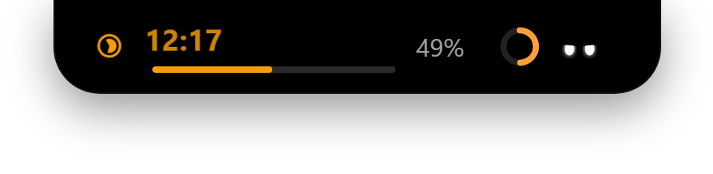
  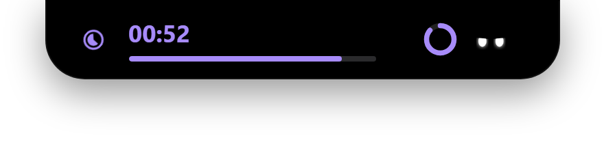

- لما التايمر يخلص بيظهر "Time is up" **3 ثواني** وبعدين بيتقفل لوحده، من غير ما تدوس Dismiss. (Restart وDismiss لسه شغالين في الـ3 ثواني دول.)
- في آخر 10 ثواني من التايمر الحلقة والرقم بيحمروا.
- الحلقة الصغيرة بتتملي بسلاسة مع الوقت (مش بتقفز كل ثانية)، وأيقونتها الساعة اللي بتلف بلون التايمر أو الستوب ووتش.

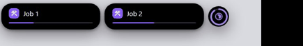

### ضبط التايمر: مسطرة لحد ساعتين

بدل العجلتين، المسطرة بنفس فكرة موبايلك: علامات كل دقيقة وأرقام كل 5. **اسحبها** يمين وشمال، أو بعجلة الماوس (نقرة = دقيقة، ومع Shift = 5 دقايق)، أو بالأسهم. بتكمّل بحركة بعد ما تسيبها وبتقف على أقرب دقيقة بارتداد خفيف. والأقصى **120 دقيقة**.

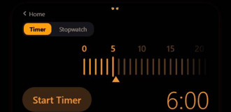

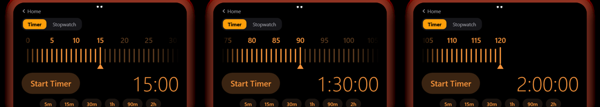

- **صوت تروس**: نقرة ميكانيكية مع كل علامة بتعدّي، أعمق كل 5 دقايق وأعمق كمان كل 15.
- أزرار قفز سريعة: 5m و15m و30m و1h و90m و2h.
- **الجزيرة بتفضل مفتوحة** وإنت بتضبط: مش بتتقفل لو الماوس خرج منها. بتتقفل لما تدوس بكليك بره عن قصد، أو ترجع بزرار Home، أو تدوس Start Timer.
- **Cancel** على تايمر شغّال بيرجعك لشاشة الضبط على طول.
- الثواني اتشالت: المسطرة بالدقيقة.

---

## أكتر من مهمة مع بعض

لما يبقى فيه أكتر من مهمة شغّالة، كل واحدة بتاخد pill، وده بيحصل بحركة سائلة:

- **الانفصال**: لما مهمة تانية تبدأ، الكبسولة بتتمدد شوية وبتتفصل منها قطرة بتستقر جنبها بحركة مرنة.
- **الاندماج**: لما مهمة تخلص، الـ pills بترجع تدوب في بعض في كبسولة واحدة بنطّة زنبركية خفيفة.
- بتشتغل بنفس الطريقة مهما كان عدد المهام.

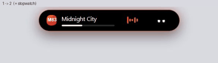

**أقصى حاجة 3 أشكال جنب بعض**: pillين وحلقة. لو المهام أكتر من 3 الباقي بيتجمّع في الحلقة بشارة `+N`. ولما يتضاف نشاط **رابع أو خامس**، كارد القائمة بيتفتح لتحت لمدة 3 ثواني بنفس الحركة عشان تشوف إنه اتضاف، والقائمة بتنزل له وللنشاط اللي فوقه على طول، وبعدين الكل بيرجع للشكل الثلاثي.

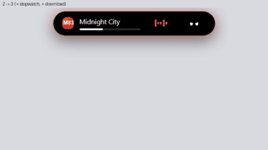

التايمر والستوب ووتش وسط مهام تانية بيحافظوا على شكلهم: ساعة بتلف، رقم ملوّن بيتحرك كل ثانية، وآخر 10 ثواني أحمر.

  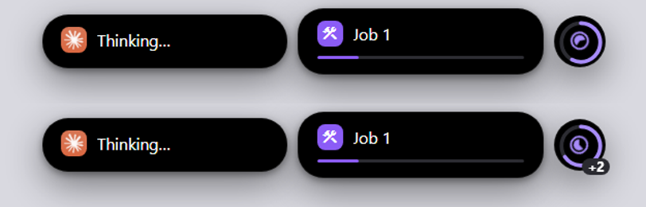
  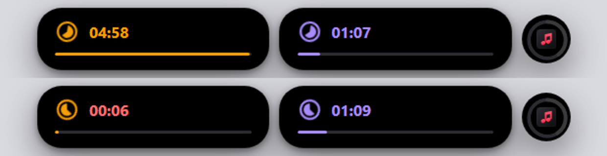

**دايرة حد الـ 5 ساعات** بتظهر لما الوكيل شغّال: لو فيه مكان بتبقى دايرة لوحدها في آخر الصف، ولو المهام كترت بتتحط على الحلقة `+N` (من غير اللوجو) ما لم يكن جواها تايمر أو ستوب ووتش، فبيحتفظوا بشكلهم.

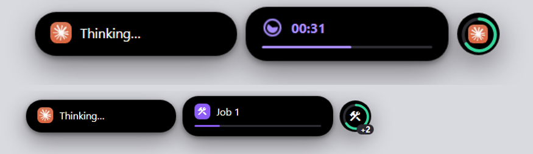

اضغط على أي نشاط في القائمة أو في "Running now" في الرئيسية يفتحلك الكارد بتاعه (الموسيقى تفتح الموسيقى، والتايمر يفتح التايمر...)، وأزرار الصف نفسها بتشتغل لوحدها. والقائمة بتتحرك بالعجلة من غير شريط سكرول.

---

## التحكم في الصوت

مستوى الصوت العام، وبرنامج برنامج (لو أكتر من برنامج بيشغّل صوت في نفس الوقت).

## الواي فاي والبلوتوث

تشغيل/إقفال، اتصال وفصل، ونسيان الشبكة — كل ده من غير ما تفتح إعدادات ويندوز.

  
  

## الإشعارات والرف

الإشعارات بقت بتعرض **اللي محتاج نظرك بس**: مهمة خلصت، مهمة فشلت، أو وكيل ذكاء اصطناعي مستنيك. "Claude مستنيك" بيظهر مرة واحدة (مش بيتكرر 60 مرة) وبيختفي لوحده أول ما Claude يكمّل. والرف مكان تسيب فيه ملفات مؤقتًا وتسحبها لأي برنامج أو مجلد، وتقدر تحوّلها من عليه (تحت).

  
  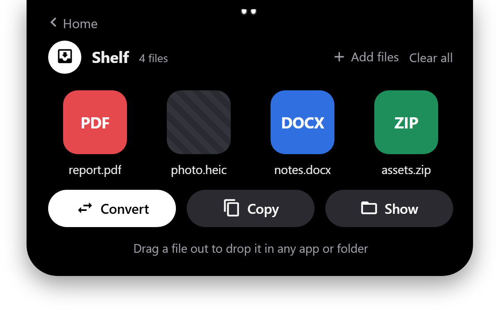

---

## محوّل الملفات (Convert)

حوّل الصور والـ PDF من غير ما تفتح أي برنامج تاني — اسحب الملفات على الجزيرة واختار الصيغة.

### إزاي بيشتغل

لما تسحب ملف ناحية الجزيرة بتفتح **منطقتين للإفلات**: **Convert** (أخضر) و**Shelf** (أزرق). اللي تفلته على Convert بيروح للمحوّل على طول، واللي تفلته على Shelf بيتحفظ على الرف. وفي الرف نفسه فيه زرار **Convert** بيحوّل اللي عليه.

  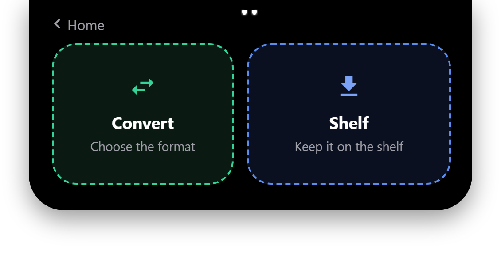
  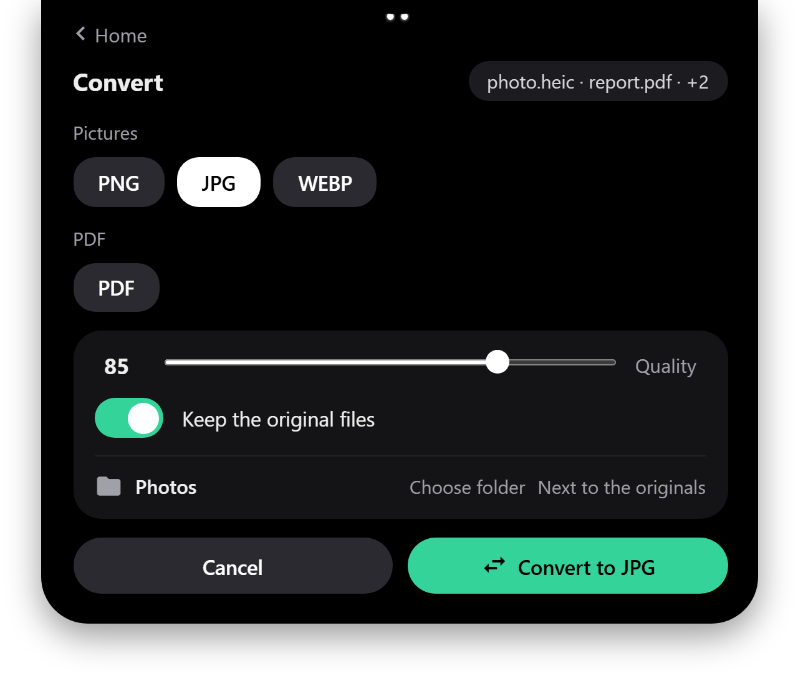

### اللي بيحوّله

| من | إلى |
|---|---|
| PNG / JPG / WEBP / BMP / GIF / ICO | JPG / PNG / WEBP |
| **HEIC / HEIF** (صور الآيفون) | JPG / PNG / WEBP |
| أي صور | **PDF** (ملف واحد فيه كل الصور صفحة صفحة، أو ملف لكل صورة) |
| **PDF** | **صور**: فولدر جديد باسم الـ PDF جواه `1.jpg` و`2.jpg` و`3.jpg`... بترقيم الصفحات |

- **الجودة**: شريط للـ JPG والـ WEBP.
- **مكان الحفظ**: أول مرة بيسألك تحفظ فين (أو جنب الملف الأصلي)، وبيفتكر اختيارك. ومفيش ملف بيتكتب فوق ملف: لو الاسم موجود بيطلع `اسم (2)`.
- **الاحتفاظ بالأصلية**: شغّال افتراضيًا. لو طفيته الأصل بيروح لسلة المحذوفات (مش بيتمسح نهائيًا).
- لو الجزيرة مقفولة والتحويل شغّال بتشوف **pill صغير** بالتقدّم، ولما يخلص بيظهر كارد بالنتايج تقدر **تسحب منه أي ملف** لأي تطبيق أو مجلد، أو تفتح المجلد.

  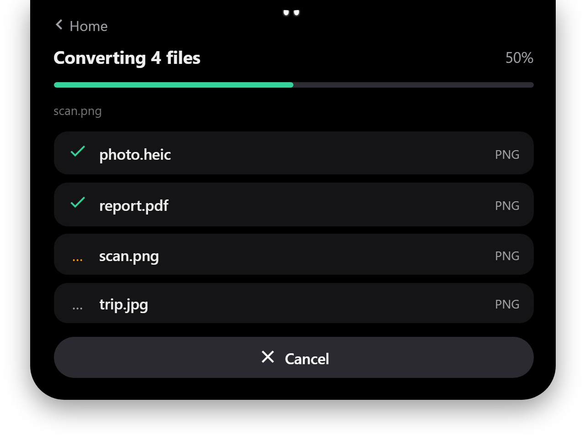
  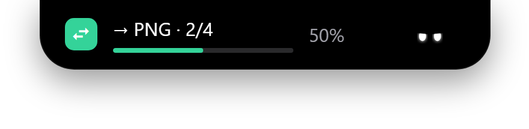
  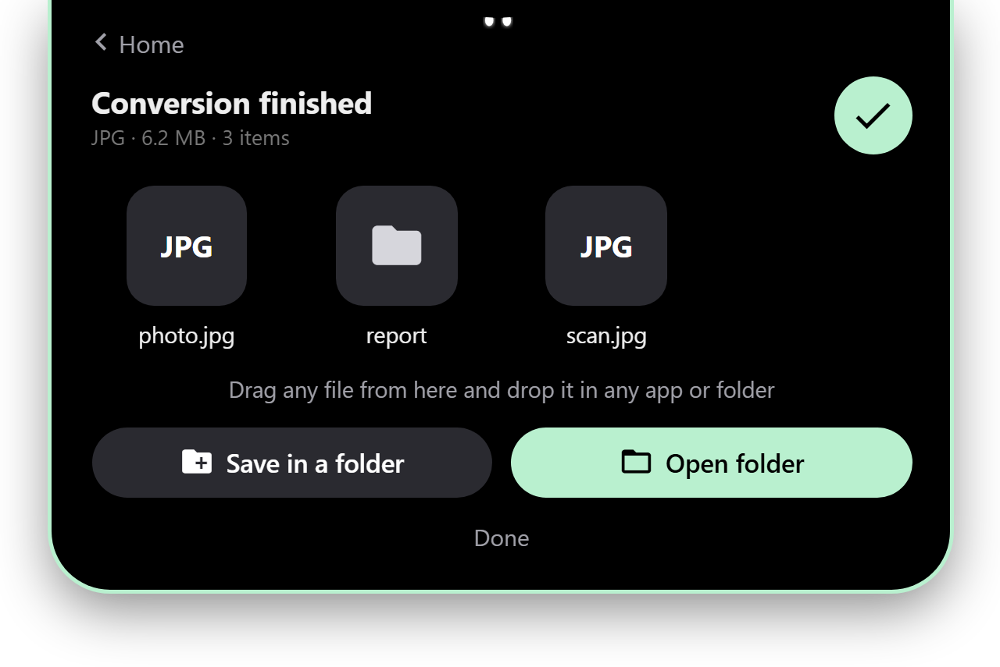

العيون كمان بتشارك: بتتفاجأ لما التحويل يبدأ، وتفرح وتطلّع كونفيتي لما يخلص.

### مكتبات HEIC وPDF بتتنزّل لما تحتاجها بس

تحويل HEIC وPDF محتاج مكتبتين (حجمهم حوالي 1.5MB و6MB). **مش جوه التثبيت**: أول مرة تبدأ تحويل محتاج واحدة منهم، نوتش بيورّيك كارد "بنجهّز المحوّل" لحد ما تتنزّل، وبعدين التحويل يبدأ لوحده. بتتنزّل من [Releases](../../releases/tag/engines-1) هنا، وموقّعة رقميًا ومتحقق منها قبل الاستخدام. صور PNG/JPG/WEBP العادية مش بتحتاج أي تنزيل. بعد التحويل النافذة المؤقتة بتتقفل، فمفيش استهلاك وهو ساكت.

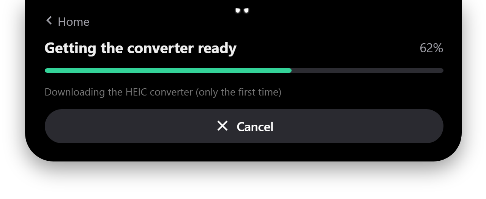

---

## مراقب وكلاء الذكاء الاصطناعي (AI Agent)

كارد بيورّيك كل جلسة Claude Code وCodex شغّالة، في تابات: اسم المشروع، وحالتها (**جاهز / شغّال / مستنيك / خلص / خطأ**)، وكل خطوة بتعملها.

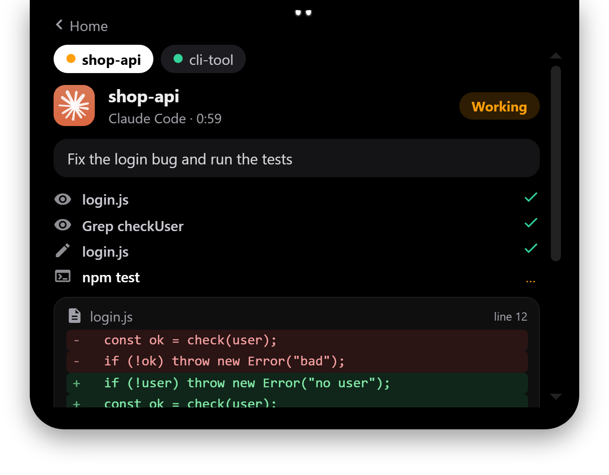

- **الخطوات**: سطر لكل أداة (قراية، تعديل، أمر...)، بعلامة ✓ لما تخلص و✕ لو فشلت.
- **التغيير الحالي**: diff صغير أحمر/أخضر (3 سطور قديمة و3 جديدة) برقم السطر.
- **ناتج التيرمنال**: آخر سطور اللي الأمر طبعه.
- **ملخص المهمة**: الملفات اللي اتعدلت وعدد الأوامر.
- **الأرقام**: الموديل، ونسبة الـ context، وفاضل كام من حدّ الـ 5 ساعات وحدّ الأسبوع.
- لما الجلسة تخلص أو تفشل وتفتح الكارد لحظة، بترجع "جاهز" (يعني اتشافت).

### لما Claude يسألك

أسئلة الاختيارات (`AskUserQuestion`) والموافقة على الخطة (`ExitPlanMode`) بتظهر كاردات حقيقية: بتختار من الاختيارات (واحد أو أكتر) أو تكتب إجابتك، أو توافق على الخطة أو ترجّعها بملاحظاتك. وطلبات الإذن العادية (Allow / Deny) زي ما هي.

  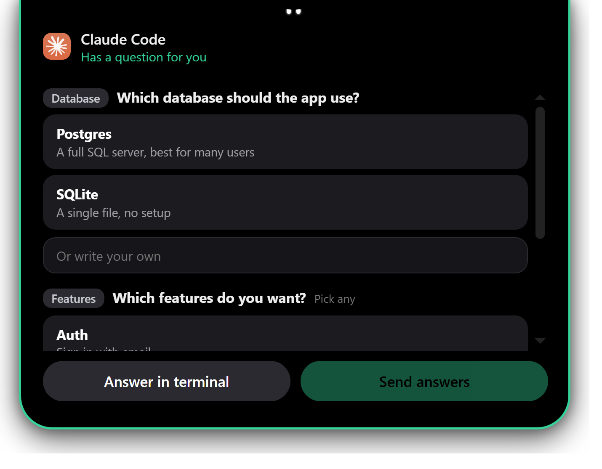
  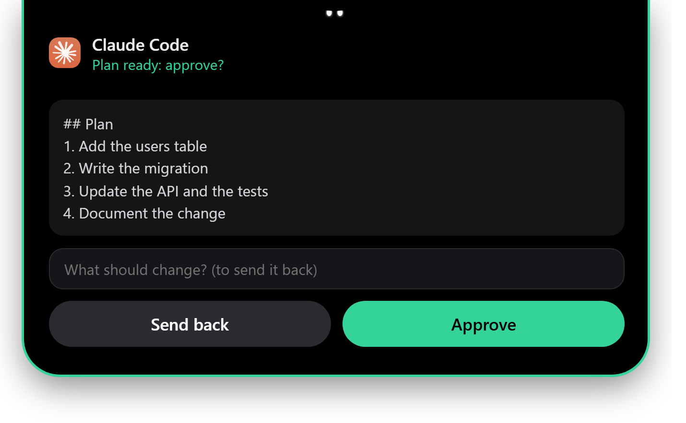

### رد على Claude من الجزيرة

لما Claude يخلص ويسألك سؤال أو يستنى كلامك، فيه خانة تكتب فيها ردك وتبعته، ويوصل لـ Claude كأنك كتبته في التيرمنال.

  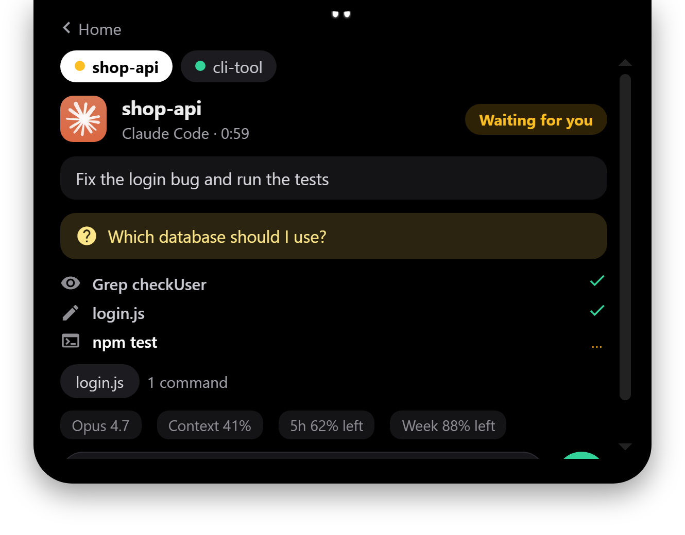
  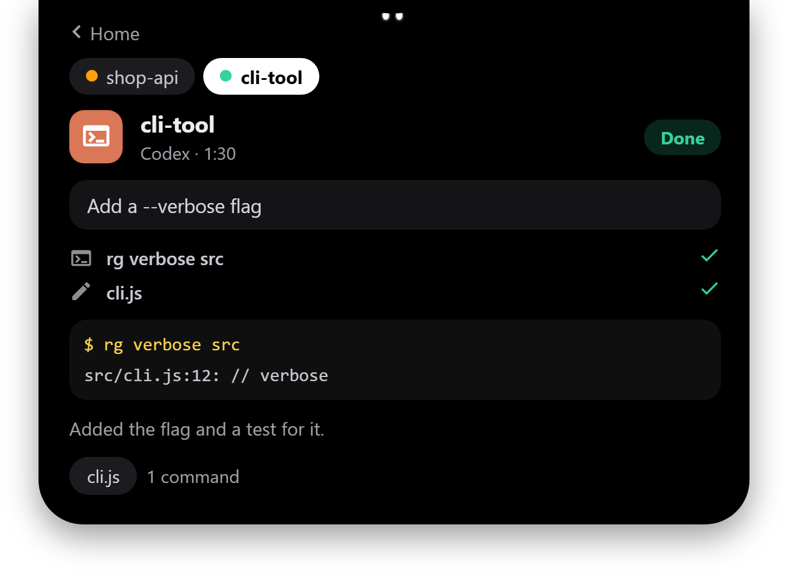

> ده شغّال بـ hook صغير بيستنى في الخلفية بعد كل رد من Claude Code (لحد 30 دقيقة). لو مش عايزه، طفيه من **Settings ← AI & Robo ← Answer Claude from the island**.

### Codex

Codex دلوقتي بيبعت لنوتش شغله كله (الخطوات والأذونات ونهاية كل دور) عن طريق hooks كاملة في `~/.codex/hooks.json`، وبيظهر في نفس الكارد. أذونات Codex بتتجاوب في نافذة Codex نفسها.

---

## حلقة استخدام Claude (الـ 5 ساعات)

لما Claude بيشتغل، حلقة صغيرة جنب العينين بتورّيك حدّ الـ 5 ساعات بتاعك (الأرقام الحقيقية من Claude Code نفسه). لونها أخضر، وبتبقى أصفر لما يفضل 30% أو أقل، وأحمر لما يفضل 10%.

اختار الشكل اللي يريحك من **Settings ← AI & Robo ← 5-hour usage ring**:

- **بتنقص كل ما أستخدم** (الافتراضي): الحلقة بتبدأ كاملة وتفضى لما الليمت يخلص.
- **بتتملي كل ما أستخدم**: بتبدأ فاضية وتتملي لما الليمت يخلص.

  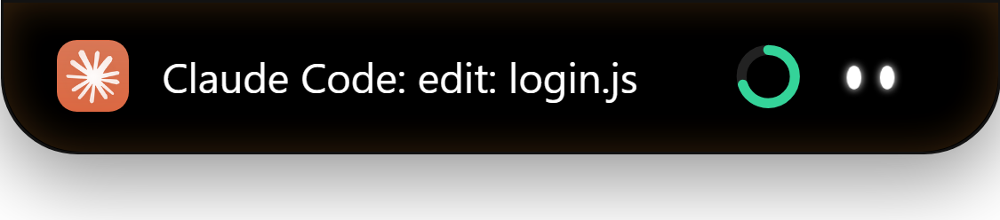
  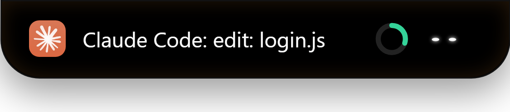

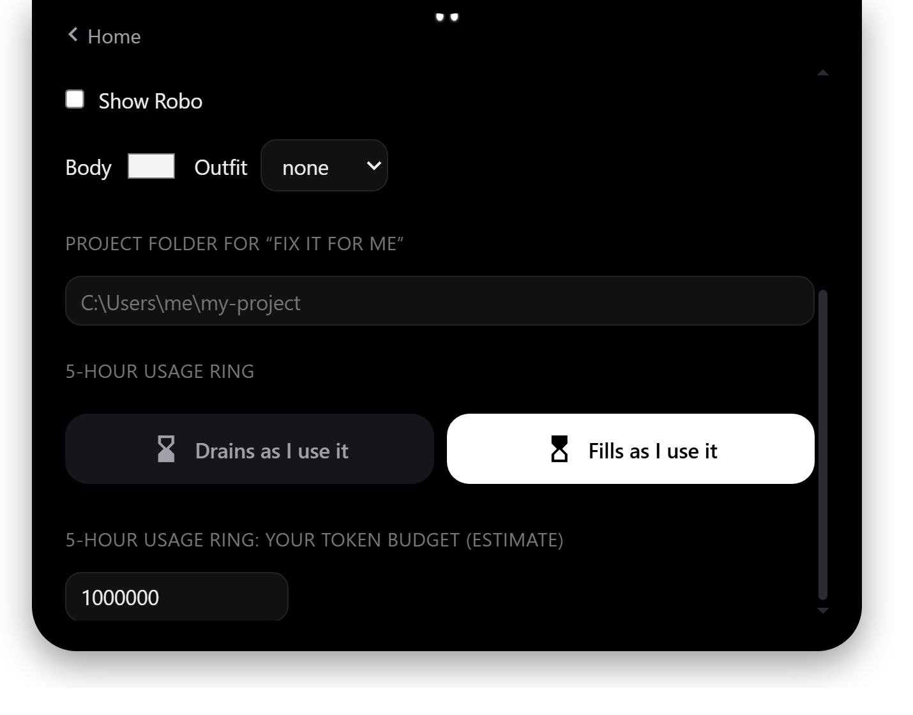

---

## لما المايك أو الكاميرا تشتغل

إشعار سريع (ثانيتين) بلون المايك (برتقالي) أو الكاميرا (أخضر)، وبعدها نقطة ثابتة بنفس اللون — جنب العينين لو مفيش حاجة تانية شغالة، أو جوه حلقة الاستخدام لو فيه حاجة شغالة فعلاً.

  
  

---

## بطارية بتتشحن، وتنبيه لما تخلص عملية

تنبيهات البطارية بقت كبسولة كبيرة: الكلام على الشمال (النسبة وإيه المطلوب) وكبسولة فيها بطارية على اليمين:

- **أحمر** لما البطارية تقل (20% و10%): الكبسولة بتنبض والشريط الأحمر بيرمش، وأسرع في الحالة الحرجة.
- **أخضر** لما توصّل الشاحن: شريط الشحن بيتملي ويكرر.
- **أخضر** لما البطارية تكمل: الشريط يتملي للآخر ولمعة بتعدّي على الكبسولة.

  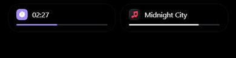
  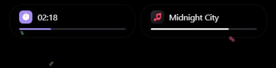
  

وفيه كمان احتفال صغير (كونفيتي) وصوت مميز لما عملية طويلة تخلص.

  
  

---

## كليك يمين = خط رفيع

عايز الجزيرة تختفي من غير ما تقفلها؟ كليك يمين عليها وتتحول لخط رفيع تحت أعلى الشاشة، وأي حركة ماوس فوقه بترجّعها زي ما كانت.

---

## إعدادات شاملة

تحكم كامل في شكل الجزيرة، الأصوات، اللغة، وتفعيل/تعطيل أي نشاط (تنبيهات الـ CPU والـ RAM، نقطة المايك/الكاميرا، سجل الحافظة، التنزيلات...) حسب ما يريحك.

  
  

### اللغة العربية بالكامل

غيّر اللغة من الإعدادات، والواجهة كلها بتتحول RTL فورًا بخط **Teshrin**.

  
  

---

## إضافة المتصفح

تقدر تثبّت إضافة Chrome/Edge من جوه نفس التطبيق (Settings ← General ← Install the browser extension)، بتخلي نوتش يعرف لما ChatGPT أو Claude أو Gemini أو NotebookLM يخلصوا الرد، وتجيب احتفال خاص بيهم.

---

## اختصارات لوحة المفاتيح (تقدر تغيّرها)

من **Settings ← Shortcuts**: دوس على أي اختصار وبعدين دوس المفاتيح الجديدة. `Esc` بيلغي، و`Delete` بيطفي الاختصار، وزرار Reset بيرجّع كل حاجة. البرنامج بيرفض الاختصار المتكرر، وبيقولك لو برنامج تاني واخد نفس المفاتيح.

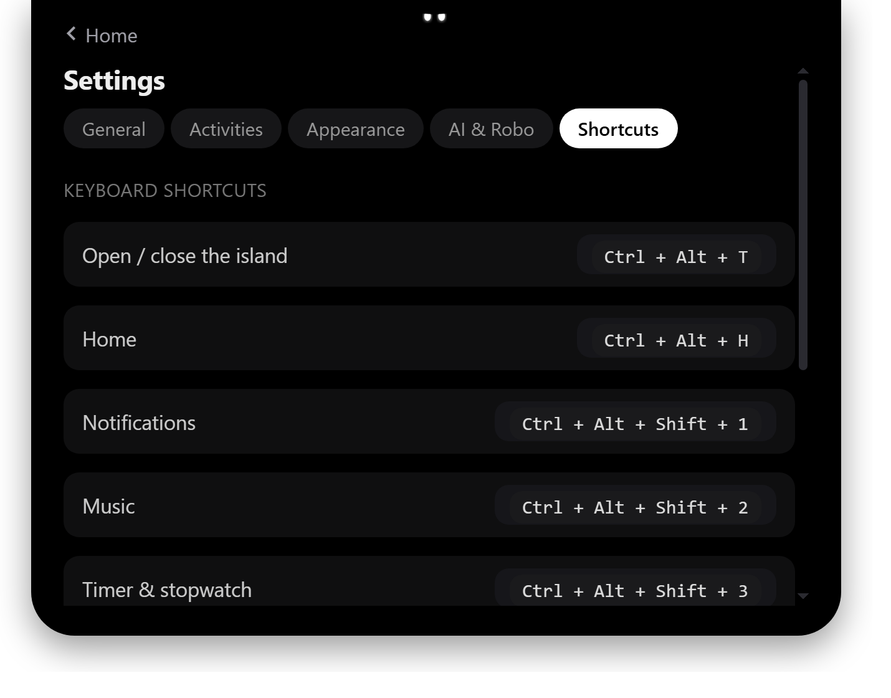

| الاختصار الافتراضي | الوظيفة |
|---|---|
| `Ctrl+Alt+T` | فتح / قفل الجزيرة |
| `Ctrl+Alt+H` | الرئيسية |
| `Ctrl+Alt+Shift+1` | الإشعارات |
| `Ctrl+Alt+Shift+2` | الموسيقى |
| `Ctrl+Alt+Shift+3` | المؤقت وساعة الإيقاف |
| `Ctrl+Alt+Shift+4` | AI Agent |
| `Ctrl+Alt+Shift+5` | الرف |

> الصفحات كانت على `Ctrl+Alt+1..4`. على كيبوردات كتير (إسباني، فرنسي، ألماني...) ويندوز بيبعت `Ctrl+Alt` لزرار AltGr، فكتابة حرف زي `@` كانت بتفتح صفحة من الجزيرة بالغلط. عشان كده نقلناها لـ `Ctrl+Alt+Shift`.

---

## التحديث التلقائي

نوتش بيدوّر على نسخة جديدة وقت ما يفتح، وكل 20 دقيقة تقريبًا، وأول ما الجهاز يصحى من النوم أو يتفتح من القفل (فلو الجهاز كان مقفول وقت ما النسخة نزلت، هتتركّب أول ما ترجعله). النسخة بتتنزّل وبتتأكد من توقيعها الرقمي، وبعد ثواني بتتركّب لوحدها وبيفتح من جديد، **إلا لو فيه سؤال من agent مستنيك** (مش هيقفل عليك وانت بتجاوب). التحديث بيستبدل ملفات التطبيق بس، فهو صغير وسريع. وفي الأول بيظهر كونفيتي صغير يقولك "Updated" ورقم النسخة.

---

## الخصوصية

نوتش بيشتغل بالكامل على جهازك — كل البيانات (الواي فاي، البلوتوث، الموسيقى، الإشعارات، شغل الـ agents، الملفات اللي بتحوّلها) بتتقرا وبتتعالج محليًا ومتتبعتش لأي سيرفر. الاتصال الوحيد بالإنترنت هو تنزيل التحديثات ومكتبتي المحوّل (HEIC وPDF) من صفحة Releases هنا لما تحتاجهم. إضافة المتصفح بتتكلم بس مع نوتش على نفس الجهاز، من خلال توكن سري يتولّد تلقائيًا لكل جهاز.

---

## متطلبات التشغيل

ويندوز 10 أو 11 (64-bit).
