# Notch

**Dynamic Island لويندوز** — شريط صغير شفاف أعلى الشاشة، بيوريك اللي شغال دلوقتي ويديك تحكم سريع من غير ما تفتح حاجة.

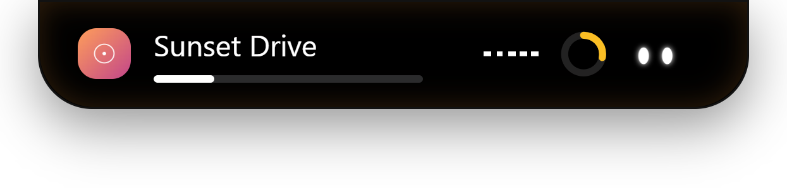

---

## الجديد في 1.0.23

- **التحميلات جوه الجزيرة:** أي حاجة بتنزّلها من Chrome أو Edge بتظهر في الجزيرة: نزّل قد إيه وبسرعة كام (MB/s). ومع إضافة المتصفح بتشوف اسم الملف والنسبة المظبوطة. بيراقب الفولدرات اللي المتصفح بيحفظ فيها فعلاً (مش Downloads بس). ولما التحميل يخلص: كونفتي ونغمة خاصة بيه.
- **الموسيقى بتفضل لحظة بعد ما توقفها (زي الآيفون):** وقّف أغنية أو اقفل المشغّل، والجزيرة بتسيبها حوالي 5 ثواني بشكل "موقوف" (غلاف صغير معتّم ونقط بدل الموجات) وبعدها بتختفي. دوس تشغيل ترجع على طول.
- **الهوفر بيفتح اللي تحت الماوس:** لو فيه نشاط واحد في الجزيرة، الهوفر عليه بيفتح كارته هو (الموسيقى أو Claude) بدل الرئيسية.
- **أغلفة المتصفح:** غلاف أغاني وفيديوهات يوتيوب بيظهر بشكل أضمن بعد ما تغيّر الفيديو.
- **إضافة المتصفح 1.3.0:** أيقونة جديدة، بتعرض التحميلات، وبتتحدّث لوحدها بعد أول تثبيت (الإعدادات ثم إضافة المتصفح).

---

## الجديد في 1.0.22

أكبر تحديث لحد دلوقتي:

- **تحكم لحظي**: التشغيل والإيقاف والتالي والسابق والصوت بيردّوا في نفس اللحظة. وسكرول الماوس على صف الصوت في كارت الموسيقى أو الميكسر بيغيّر الصوت (5% لكل نقرة). [التفاصيل](#الموسيقى)
- **كلمات الأغاني** بتتحرّك مع الأغنية، وفي الـ pill نفسه لو دوست على زرار الكلمات. [التفاصيل](#الكلمات-lyrics)
- **ترجمة** عربي ⇄ إنجليزي (و28 لغة) من الجزيرة. [التفاصيل](#الترجمة)
- **نسخ النص من الشاشة (OCR)**: اختار منطقة والنص يتنسخ، أو الصق صورة بـ Ctrl+V. [التفاصيل](#نسخ-النص-من-الشاشة-ocr)
- **زجاج شفاف** زي زجاج Apple، مع تحكم في الشفافية. [التفاصيل](#زجاج-شفاف)
- **بانرات بأنيميشن خاص** لتغيير لغة الكيبورد (Alt+Shift) ولـ Caps Lock، وتقدر تطفيهم. [التفاصيل](#بانرات-لغة-الكيبورد-وcaps-lock)
- **Antigravity** من Google بيتراقب زي Claude Code وCodex. [التفاصيل](#antigravity)
- **أنغامي**: الاسم والفنان والتحكم، ومع الربط الغلاف والمدة وShuffle وRepeat. [التفاصيل](#أنغامي-anghami)
- توهّج أخضر ناعم تحت الجزيرة لما حاجة تنجح، والعينين بقوا دهبي مع صوت عملات وإنت بتحرّك مسطرة التايمر.

---

## الجديد في 1.0.19

- **حركة سلسة**: الغلاف بيطير من مكانه لمكانه الجديد، والشاشات بتتبدّل بدون وقفة، والنصوص بتنزلق، والأرقام بتعدّ، والشريط لما يوصل 100% بيتحوّل لعلامة ✓. [التفاصيل](#حركات-سلسة)
- **أكتر من مهمة مع بعض**: الكبسولة بتنفصل لقطرات وبترجع تدوب في بعض، ودايرة حد الـ 5 ساعات بتاخد مكانها في الصف. [التفاصيل](#أكتر-من-مهمة-مع-بعض)
- **ضبط التايمر على مسطرة** لحد ساعتين، بصوت تروس. [التفاصيل](#ضبط-التايمر-مسطرة-لحد-ساعتين)
- **تنبيهات البطارية** بشكل جديد: أحمر لما تقل، وأخضر لما تتشحن أو تكمل. [التفاصيل](#بطارية-بتتشحن-وتنبيه-لما-تخلص-عملية)
- **الموسيقى**: أزرار أكبر، وأيقونة جديدة لما مفيش غلاف، واضغط على اسم الأغنية يفتحلك برنامجها (أو التاب بتاعها في المتصفح). [التفاصيل](#الموسيقى)
- اضغط على أي نشاط في القائمة أو الرئيسية يفتحلك الكارد بتاعه على طول.

---

## تنزيل البرنامج

1. روح لـ [Releases](../../releases/latest) وحمّل أحدث نسخة من `Notch-Setup-x.x.x.exe`.
2. شغّل الملف. ويندوز هيورّيك تحذير "Windows protected your PC" لأن البرنامج مش موقّع بشهادة رسمية — ده طبيعي لبرنامج مستقل، دوس **More info** ثم **Run anyway**.
3. التثبيت تلقائي بالكامل (One-click) — هيتسطب ويشتغل لوحده.
4. أي تحديث جديد هينزل ويتركّب **تلقائيًا** من غير ما تعمل أي حاجة (تفاصيل تحت في [التحديث التلقائي](#التحديث-التلقائي)).

> تحذير ويندوز سببه إن البرنامج مش موقّع بشهادة (Code Signing) لسه، مش أكتر. التحديثات اللي بينزّلها نوتش لنفسه موقّعة رقميًا، وبيتأكد من التوقيع قبل ما يركّب أي حاجة.

---

## الشاشة الرئيسية

كل حاجة من مكان واحد: الموسيقى، المؤقت، الصوت، الواي فاي، البلوتوث، الإشعارات، والرف.

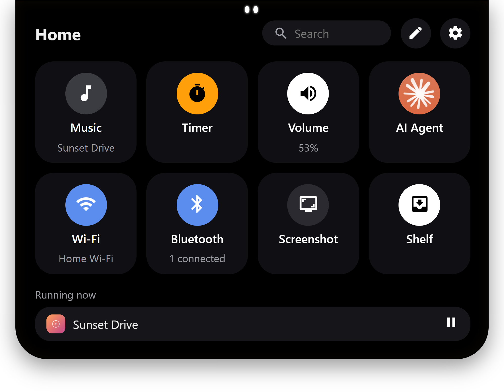

---

## الموسيقى

بيقرا اسم الأغنية والفنان والغلاف تلقائيًا من أي برنامج بيشغّل صوت (Spotify, YouTube Music, أي متصفح...)، مع تحكم كامل: تشغيل/إيقاف، تقديم/ترجيع، الصوت، Shuffle وRepeat.

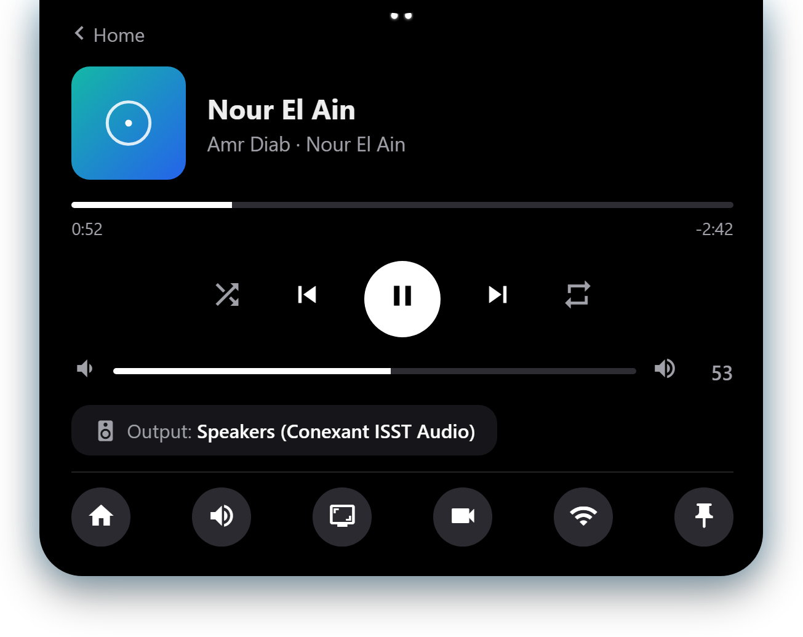

اضغط على غلاف الأغنية يكبر ويملا الجزيرة.

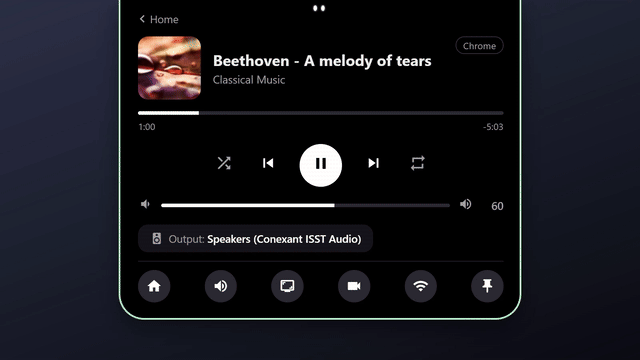

### أزرار أوضح، وأيقونة لما مفيش غلاف

أزرار التحكم بقت أكبر وأسمك (السابق والتالي أسهم ممتلئة وزرار الإيقاف أبيض كبير)، والـ Shuffle والـ Repeat فضلوا صغيرين وهادئين. ولو الأغنية من غير غلاف بتظهر أيقونة الموسيقى بتاعتنا: مربع أسود ونوتة حمرا، في الكارد وفي الـ pills وفي الرئيسية.

  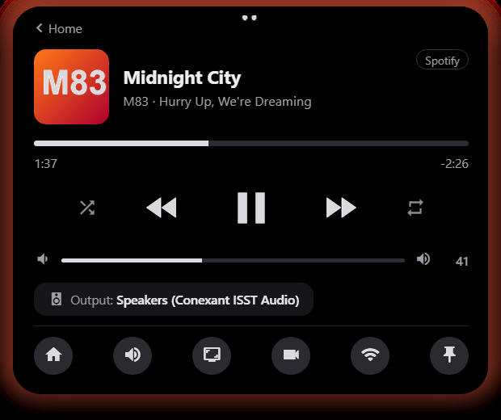
  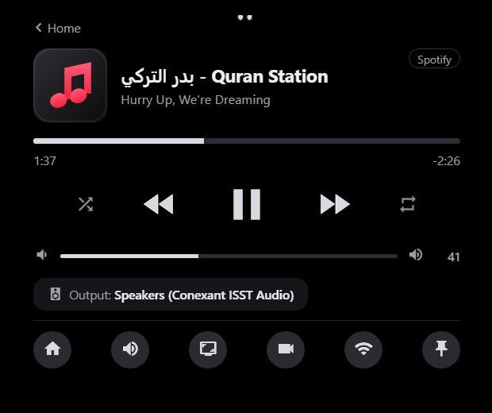

**اضغط على اسم الأغنية** يجيبلك البرنامج اللي بيشغّلها قدّام. ولو الأغنية في متصفح (Chrome أو Edge أو Brave...) بيفتحلك **التاب نفسه** حتى لو هو مش التاب الظاهر.

---

## الكلمات (Lyrics)

لما الأغنية ليها كلمات بيظهر زرار الكلمات فوق يمين كارت الموسيقى. دوس عليه: صفوف الصوت والمخرج بتفسح مكان لكلمات بتتحرّك مع الأغنية، والسطر اللي بيتغنّى دلوقتي بيكبر ويبيّض.

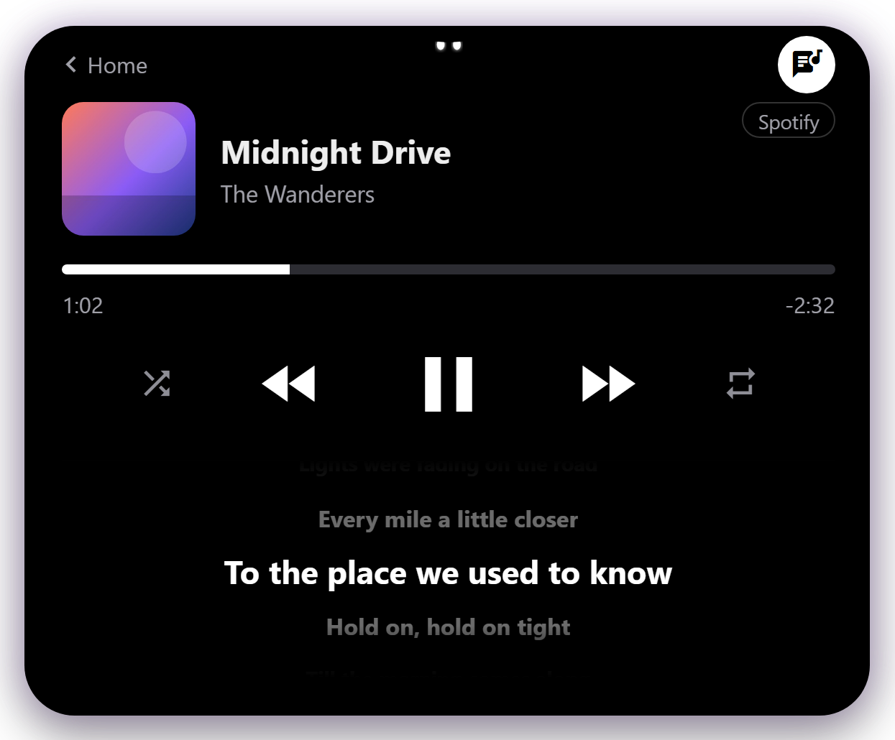

ولو سيبت الزرار شغّال، الـ pill نفسه بيعرض **السطر الحالي** (الغلاف + السطر + الموجة) بنفس الخط والحركة. اقفل الزرار يرجع الـ pill العادي باسم الأغنية.

  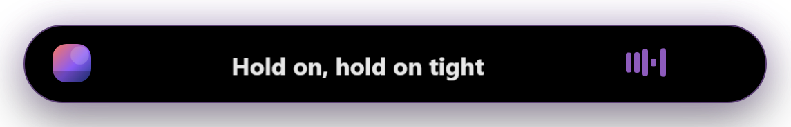
  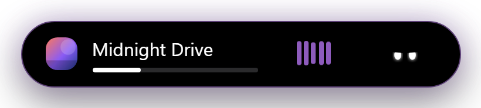

- الكلمات من [lrclib.net](https://lrclib.net): **اسم الأغنية والفنان بيتبعتوا هناك** ومفيش حاجة تانية. تقدر تطفيها من **Settings ← Activities**، ومعاها خيار "Show lyrics earlier" لو عايز السطر يظهر قبل الغنا بشوية.
- مش كل أغنية ليها كلمات هناك، خصوصًا الأغاني العربي الأقل انتشارًا. ساعتها بتشوف "Lyrics not available".

---

## أنغامي (Anghami)

تطبيق أنغامي للكمبيوتر **مبيقولش لويندوز إيه اللي بيشغّله**، فنوتش بيتعامل معاه بطريقتين:

- **من غير أي حاجة منك**: بيقرا اسم الأغنية والفنان من عنوان نافذة أنغامي، ويشتغل زرار التشغيل والتالي والسابق (بمفاتيح الميديا).
- **مع الربط**: بيقرا من أنغامي نفسه الغلاف والمدة ومكان الأغنية، وبتشتغل أزرار Shuffle وRepeat فعلًا.

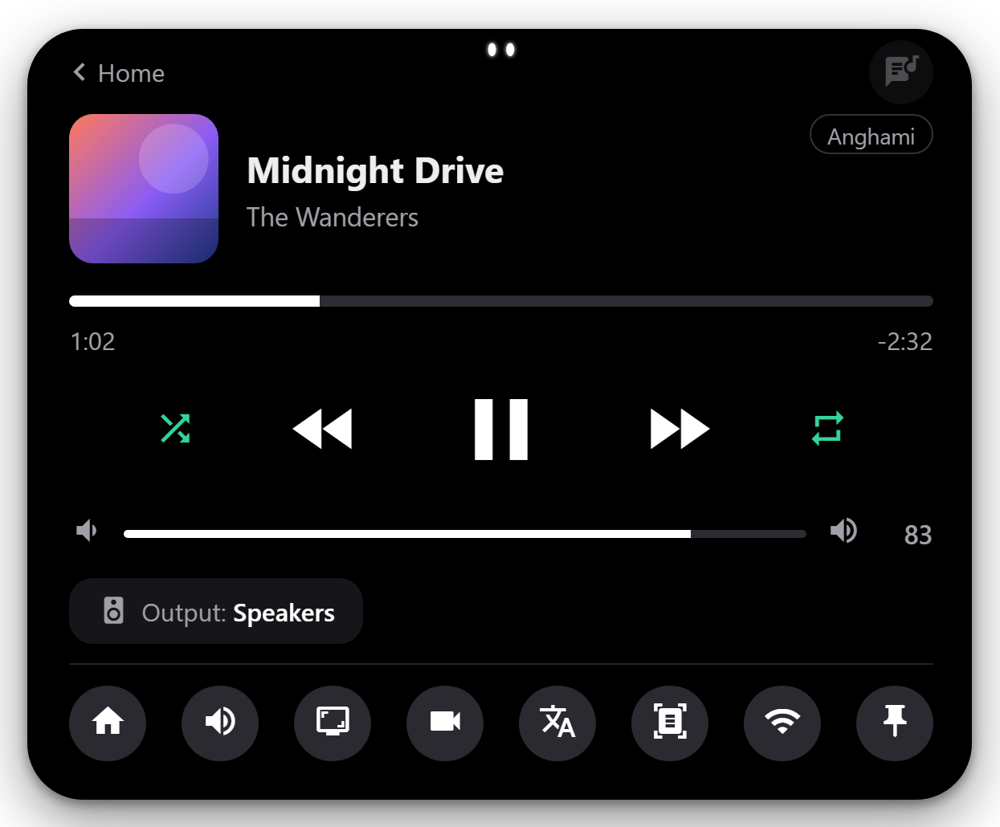

الربط بيتم **لوحده**: أول ما تفتح أنغامي، نوتش بيقفله ويفتحه تاني مرة واحدة بخيار محلي (منفذ عشوائي على جهازك بس، `127.0.0.1`)، وبعد حوالي 20 ثانية بيبدأ يقرا البيانات. ده ممكن تطفيه من **Settings ← Activities ← Anghami**، وفيه زرار "Restart Anghami and connect" لو عايز تربطه يدويًا.

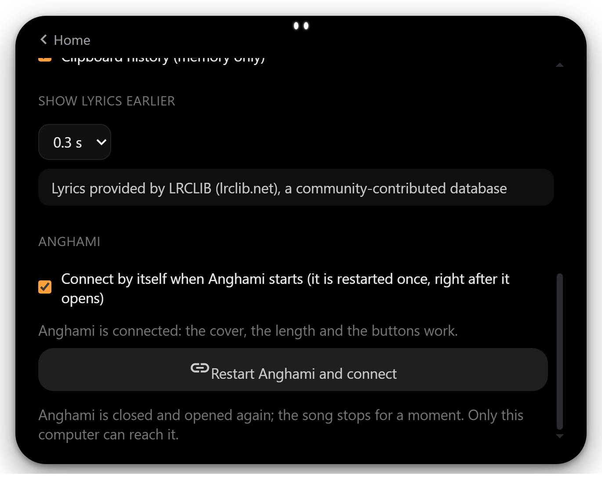

> **اللي لازم تعرفه:** الربط مش بيحرّك أنغامي من السلايدر (السلايدر بيعرض المكان بس)، وأنغامي بيتقفل ويتفتح لحظة بعد ما تفتحه. لو فتحته وهو شغّال بقاله أكتر من 25 ثانية (ممكن أغنية شغّالة) نوتش مبيلمسوش. بدون الربط الغلاف والمدة والـ Shuffle والـ Repeat مبتظهرش.

---

## حركات سلسة

الجزيرة بقت أقرب لحاجة حيّة: كل عنصر بيحافظ على هويته وهو بينتقل، مش بيختفي ويظهر في مكان تاني.

- **الغلاف بيطير**: من الأيقونة الصغيرة لحجمه في الكارد، ومن الكارد للصورة الكبيرة.
- **الدخول والخروج مع بعض**: الشاشة القديمة بتتلاشى وهي طالعة والجديدة بتدخل في نفس اللحظة.
- **النصوص بتنزلق**: اسم الأغنية القديم يطلع والجديد يدخل من تحت.
- **الأرقام بتعدّ** (46 ثم 47 ثم 48...) والشريط بيكبر معاها، ولما يوصل 100% بيتحوّل لدايرة خضرا فيها علامة ✓.

  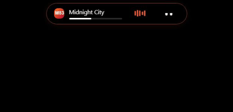
  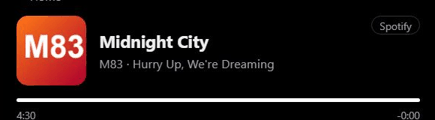

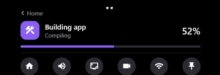

كل الحركات بتحترم إعداد **Animations** في الإعدادات: لو طفيته كل حاجة بتتغيّر فورًا.

---

## المؤقت وساعة الإيقاف (Stopwatch) — في مكان واحد

التايمر والستوب ووتش في نفس الكارد، وفوق تابين بتبدّل بينهم بضغطة. التايمر برتقالي والستوب ووتش بنفسجي.

  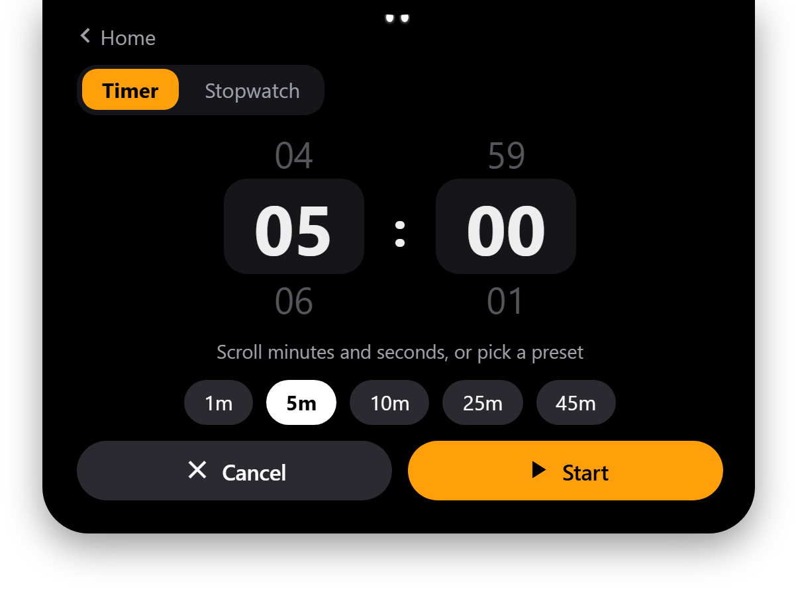
  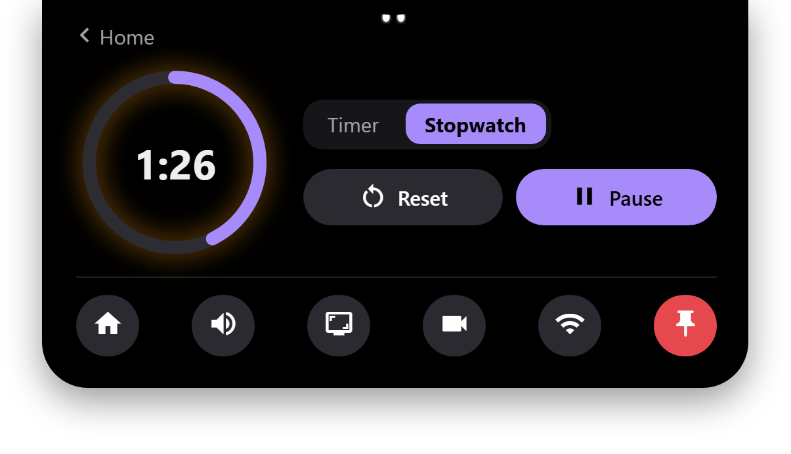

لما تقفل الجزيرة، الاتنين بيظهروا بنفس الشكل: أيقونة ساعة بتلف، رقم عريض بيتحرك كل ثانية، بار تقدّم، وحلقة جنب العينين. التايمر بيعد تنازليًا والحلقة بتفضى، والستوب ووتش بيعد تصاعديًا والحلقة بتلف مرة كل دقيقة.

  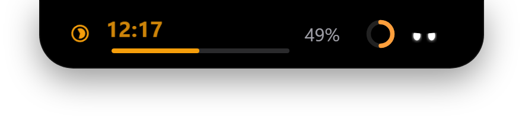
  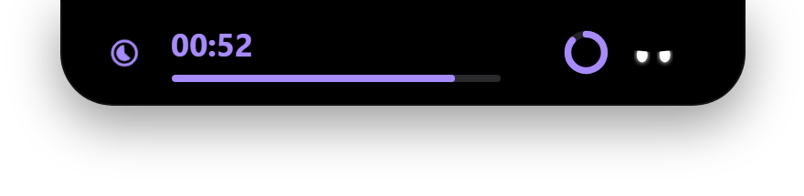

- لما التايمر يخلص بيظهر "Time is up" **3 ثواني** وبعدين بيتقفل لوحده، من غير ما تدوس Dismiss. (Restart وDismiss لسه شغالين في الـ3 ثواني دول.)
- في آخر 10 ثواني من التايمر الحلقة والرقم بيحمروا.
- الحلقة الصغيرة بتتملي بسلاسة مع الوقت (مش بتقفز كل ثانية)، وأيقونتها الساعة اللي بتلف بلون التايمر أو الستوب ووتش.

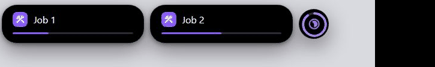

### ضبط التايمر: مسطرة لحد ساعتين

بدل العجلتين، المسطرة بنفس فكرة موبايلك: علامات كل دقيقة وأرقام كل 5. **اسحبها** يمين وشمال، أو بعجلة الماوس (نقرة = دقيقة، ومع Shift = 5 دقايق)، أو بالأسهم. بتكمّل بحركة بعد ما تسيبها وبتقف على أقرب دقيقة بارتداد خفيف. والأقصى **120 دقيقة**.

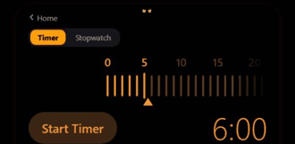

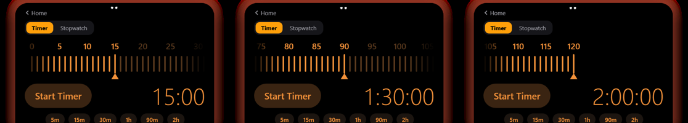

- **صوت تروس**: نقرة ميكانيكية مع كل علامة بتعدّي، أعمق كل 5 دقايق وأعمق كمان كل 15.
- أزرار قفز سريعة: 5m و15m و30m و1h و90m و2h.
- **الجزيرة بتفضل مفتوحة** وإنت بتضبط: مش بتتقفل لو الماوس خرج منها. بتتقفل لما تدوس بكليك بره عن قصد، أو ترجع بزرار Home، أو تدوس Start Timer.
- **Cancel** على تايمر شغّال بيرجعك لشاشة الضبط على طول.
- الثواني اتشالت: المسطرة بالدقيقة.

---

## أكتر من مهمة مع بعض

لما يبقى فيه أكتر من مهمة شغّالة، كل واحدة بتاخد pill، وده بيحصل بحركة سائلة:

- **الانفصال**: لما مهمة تانية تبدأ، الكبسولة بتتمدد شوية وبتتفصل منها قطرة بتستقر جنبها بحركة مرنة.
- **الاندماج**: لما مهمة تخلص، الـ pills بترجع تدوب في بعض في كبسولة واحدة بنطّة زنبركية خفيفة.
- بتشتغل بنفس الطريقة مهما كان عدد المهام.

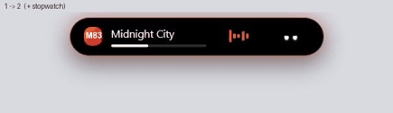

**أقصى حاجة 3 أشكال جنب بعض**: pillين وحلقة. لو المهام أكتر من 3 الباقي بيتجمّع في الحلقة بشارة `+N`. ولما يتضاف نشاط **رابع أو خامس**، كارد القائمة بيتفتح لتحت لمدة 3 ثواني بنفس الحركة عشان تشوف إنه اتضاف، والقائمة بتنزل له وللنشاط اللي فوقه على طول، وبعدين الكل بيرجع للشكل الثلاثي.

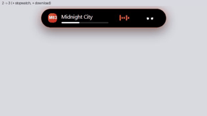

التايمر والستوب ووتش وسط مهام تانية بيحافظوا على شكلهم: ساعة بتلف، رقم ملوّن بيتحرك كل ثانية، وآخر 10 ثواني أحمر.

  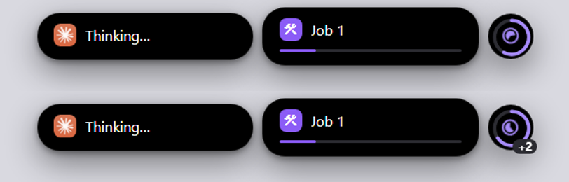
  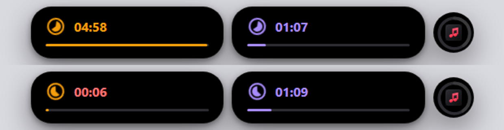

**دايرة حد الـ 5 ساعات** بتظهر لما الوكيل شغّال: لو فيه مكان بتبقى دايرة لوحدها في آخر الصف، ولو المهام كترت بتتحط على الحلقة `+N` (من غير اللوجو) ما لم يكن جواها تايمر أو ستوب ووتش، فبيحتفظوا بشكلهم.

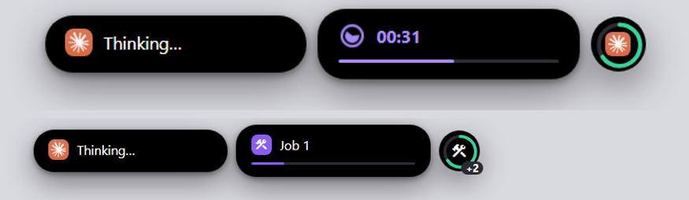

اضغط على أي نشاط في القائمة أو في "Running now" في الرئيسية يفتحلك الكارد بتاعه (الموسيقى تفتح الموسيقى، والتايمر يفتح التايمر...)، وأزرار الصف نفسها بتشتغل لوحدها. والقائمة بتتحرك بالعجلة من غير شريط سكرول.

---

## التحكم في الصوت

مستوى الصوت العام، وبرنامج برنامج (لو أكتر من برنامج بيشغّل صوت في نفس الوقت). **لفّ سكرول الماوس** على صف الصوت (في كارت الموسيقى أو هنا) يتغيّر 5% لكل نقرة، وسكرول فوق الـ pill نفسه بيغيّر الصوت العام.

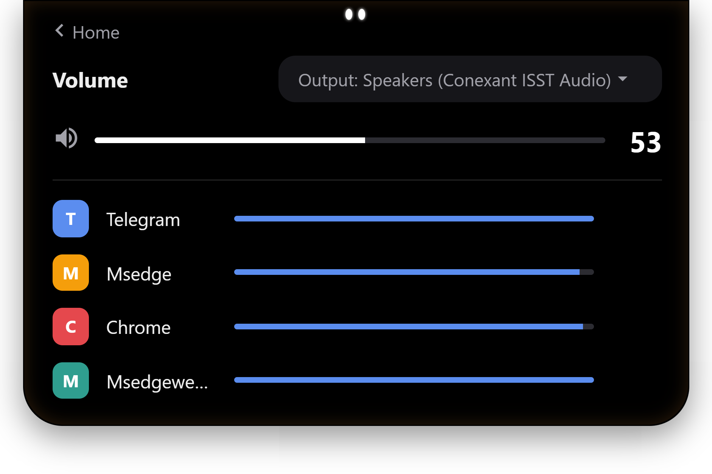

## الواي فاي والبلوتوث

تشغيل/إقفال، اتصال وفصل، ونسيان الشبكة — كل ده من غير ما تفتح إعدادات ويندوز.

  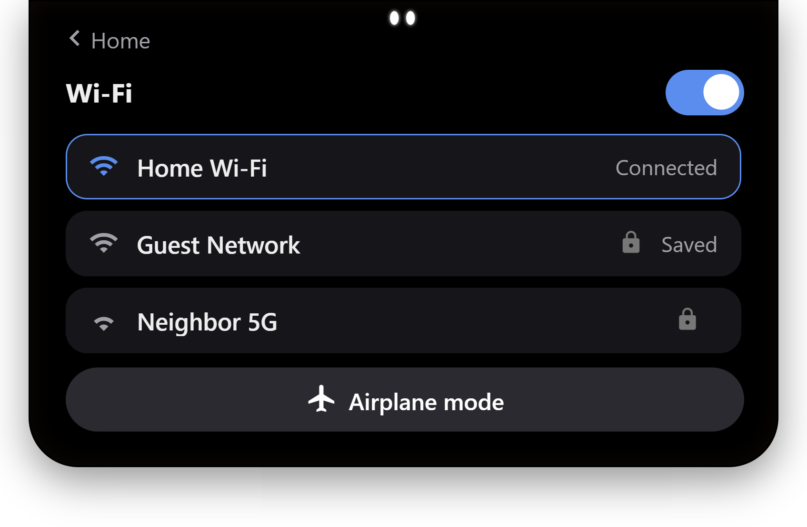
  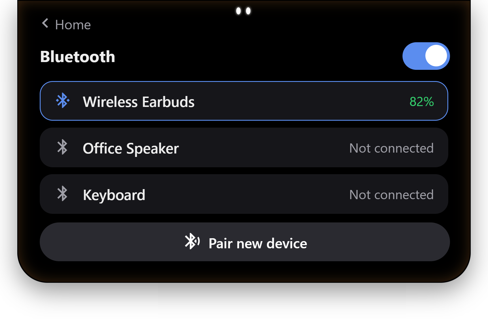

## الإشعارات والرف

الإشعارات بقت بتعرض **اللي محتاج نظرك بس**: مهمة خلصت، مهمة فشلت، أو وكيل ذكاء اصطناعي مستنيك. "Claude مستنيك" بيظهر مرة واحدة (مش بيتكرر 60 مرة) وبيختفي لوحده أول ما Claude يكمّل. والرف مكان تسيب فيه ملفات مؤقتًا وتسحبها لأي برنامج أو مجلد، وتقدر تحوّلها من عليه (تحت).

  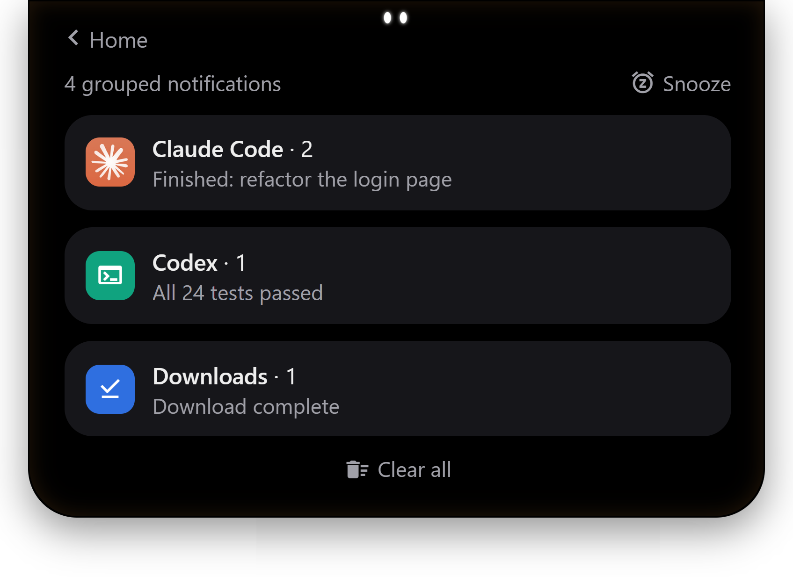
  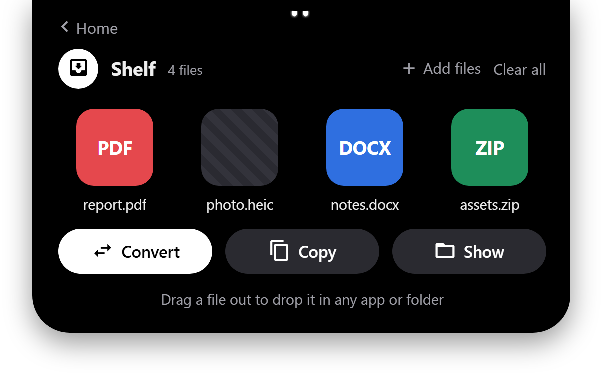

---

## محوّل الملفات (Convert)

حوّل الصور والـ PDF من غير ما تفتح أي برنامج تاني — اسحب الملفات على الجزيرة واختار الصيغة.

### إزاي بيشتغل

لما تسحب ملف ناحية الجزيرة بتفتح **منطقتين للإفلات**: **Convert** (أخضر) و**Shelf** (أزرق). اللي تفلته على Convert بيروح للمحوّل على طول، واللي تفلته على Shelf بيتحفظ على الرف. وفي الرف نفسه فيه زرار **Convert** بيحوّل اللي عليه.

  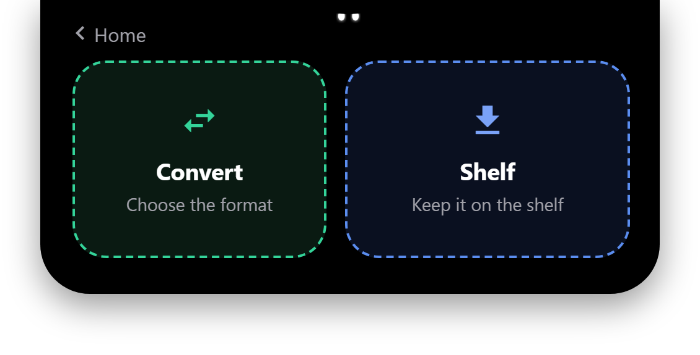
  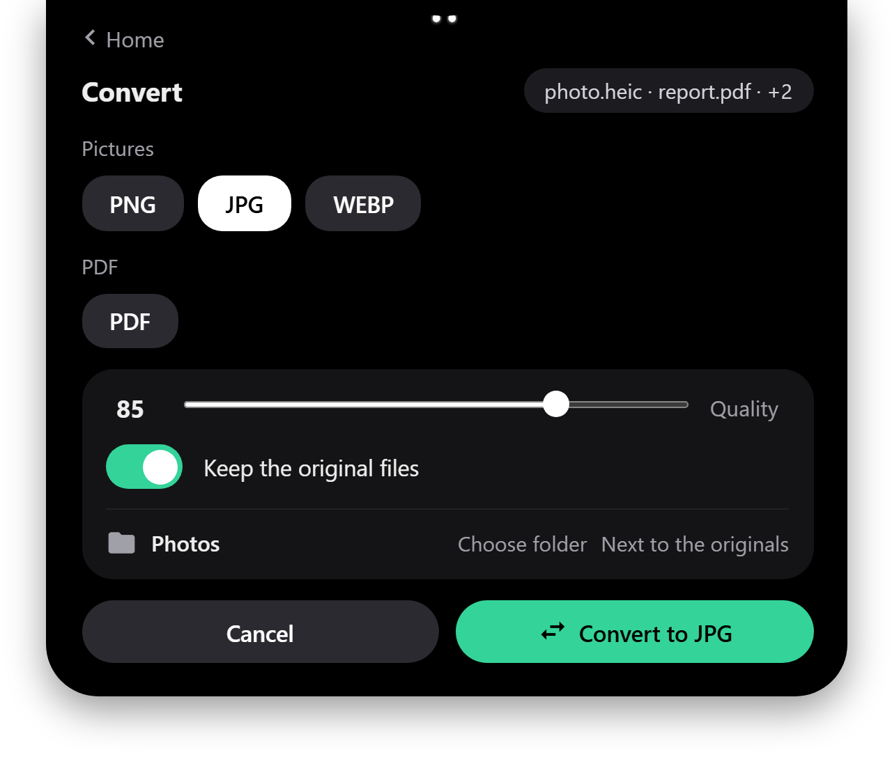

### اللي بيحوّله

| من | إلى |
|---|---|
| PNG / JPG / WEBP / BMP / GIF / ICO | JPG / PNG / WEBP |
| **HEIC / HEIF** (صور الآيفون) | JPG / PNG / WEBP |
| أي صور | **PDF** (ملف واحد فيه كل الصور صفحة صفحة، أو ملف لكل صورة) |
| **PDF** | **صور**: فولدر جديد باسم الـ PDF جواه `1.jpg` و`2.jpg` و`3.jpg`... بترقيم الصفحات |

- **الجودة**: شريط للـ JPG والـ WEBP.
- **مكان الحفظ**: أول مرة بيسألك تحفظ فين (أو جنب الملف الأصلي)، وبيفتكر اختيارك. ومفيش ملف بيتكتب فوق ملف: لو الاسم موجود بيطلع `اسم (2)`.
- **الاحتفاظ بالأصلية**: شغّال افتراضيًا. لو طفيته الأصل بيروح لسلة المحذوفات (مش بيتمسح نهائيًا).
- لو الجزيرة مقفولة والتحويل شغّال بتشوف **pill صغير** بالتقدّم، ولما يخلص بيظهر كارد بالنتايج تقدر **تسحب منه أي ملف** لأي تطبيق أو مجلد، أو تفتح المجلد.

  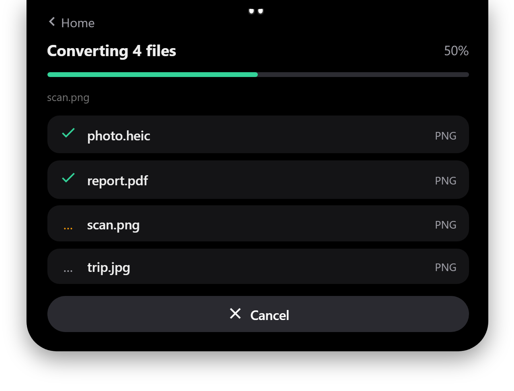
  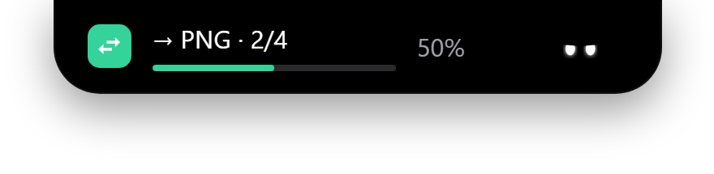
  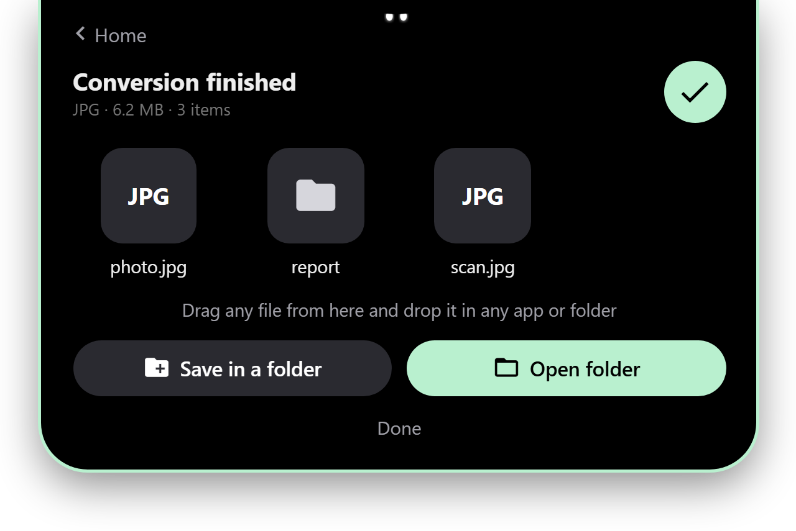

العيون كمان بتشارك: بتتفاجأ لما التحويل يبدأ، وتفرح وتطلّع كونفيتي لما يخلص.

### مكتبات HEIC وPDF بتتنزّل لما تحتاجها بس

تحويل HEIC وPDF محتاج مكتبتين (حجمهم حوالي 1.5MB و6MB). **مش جوه التثبيت**: أول مرة تبدأ تحويل محتاج واحدة منهم، نوتش بيورّيك كارد "بنجهّز المحوّل" لحد ما تتنزّل، وبعدين التحويل يبدأ لوحده. بتتنزّل من [Releases](../../releases/tag/engines-1) هنا، وموقّعة رقميًا ومتحقق منها قبل الاستخدام. صور PNG/JPG/WEBP العادية مش بتحتاج أي تنزيل. بعد التحويل النافذة المؤقتة بتتقفل، فمفيش استهلاك وهو ساكت.

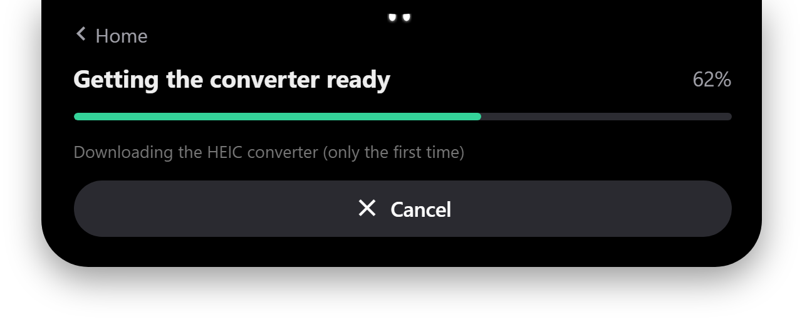

---

## الترجمة

اختصار **Ctrl+Alt+Shift+Y** أو تايل Translate. من غير ما تختار: لو النص عربي بيترجمه لإنجليزي، وغير كده بيترجمه لعربي. أو اختار أي لغة من 28 بالأسهم. اكتب أو الصق واضغط Enter.

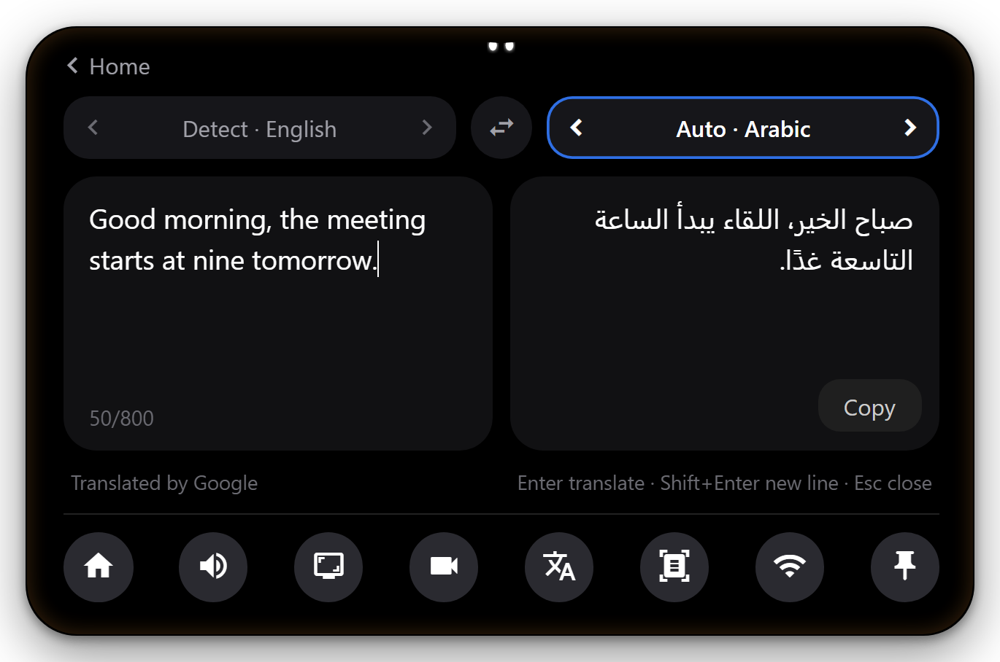

- `Enter` يترجم، `Shift+Enter` سطر جديد، `Esc` يقفل، وزرار **Copy** ينسخ الترجمة. الحد 800 حرف.
- **النص بيتبعت لخدمة ترجمة جوجل** (ولو مش شغّالة بيجرّب MyMemory). مفيش مفتاح ولا تسجيل.

---

## نسخ النص من الشاشة (OCR)

اختصار **Ctrl+Alt+O**: ويندوز بيفتحلك أداة القص، اختار أي منطقة، والنص بيتنسخ لوحده وبانر بيقولك "Copied N lines". ومن الجزيرة (تايل **Copy text**) تقدر تختار منطقة، أو تلصق صورة من الـ clipboard (زرار Paste أو `Ctrl+V`). زرار Translate بيبعت النص للترجمة على طول.

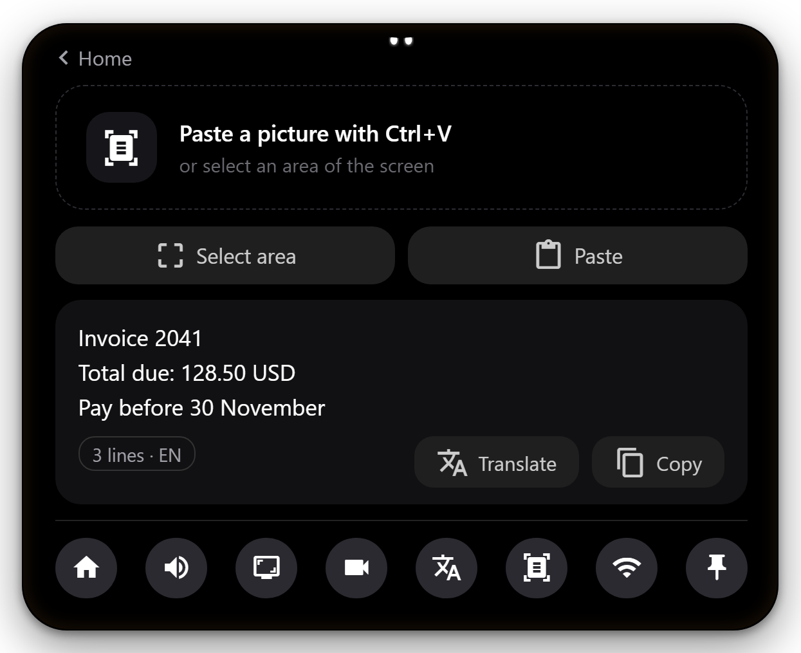

بيشتغل **من غير إنترنت** (قارئ النصوص بتاع ويندوز نفسه)، بالعربي والإنجليزي حسب اللغات المثبّتة عندك في ويندوز.

---

## مراقب وكلاء الذكاء الاصطناعي (AI Agent)

كارد بيورّيك كل جلسة Claude Code وCodex شغّالة، في تابات: اسم المشروع، وحالتها (**جاهز / شغّال / مستنيك / خلص / خطأ**)، وكل خطوة بتعملها.

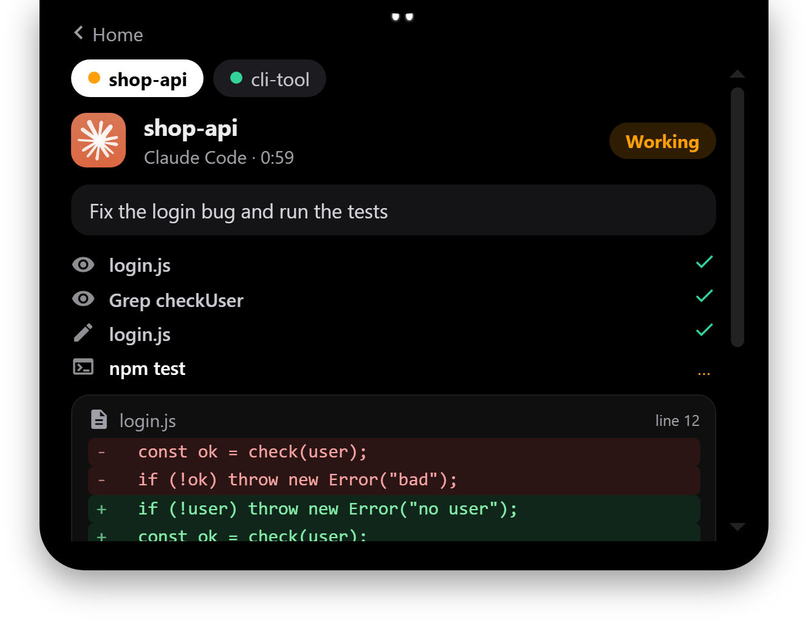

- **الخطوات**: سطر لكل أداة (قراية، تعديل، أمر...)، بعلامة ✓ لما تخلص و✕ لو فشلت.
- **التغيير الحالي**: diff صغير أحمر/أخضر (3 سطور قديمة و3 جديدة) برقم السطر.
- **ناتج التيرمنال**: آخر سطور اللي الأمر طبعه.
- **ملخص المهمة**: الملفات اللي اتعدلت وعدد الأوامر.
- **الأرقام**: الموديل، ونسبة الـ context، وفاضل كام من حدّ الـ 5 ساعات وحدّ الأسبوع.
- لما الجلسة تخلص أو تفشل وتفتح الكارد لحظة، بترجع "جاهز" (يعني اتشافت).

### لما Claude يسألك

أسئلة الاختيارات (`AskUserQuestion`) والموافقة على الخطة (`ExitPlanMode`) بتظهر كاردات حقيقية: بتختار من الاختيارات (واحد أو أكتر) أو تكتب إجابتك، أو توافق على الخطة أو ترجّعها بملاحظاتك. وطلبات الإذن العادية (Allow / Deny) زي ما هي.

  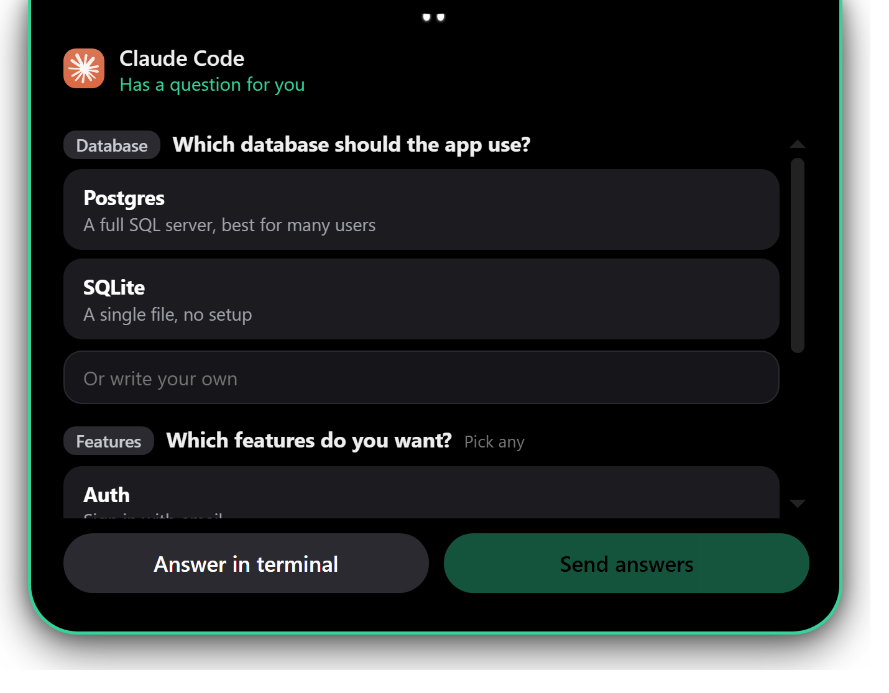
  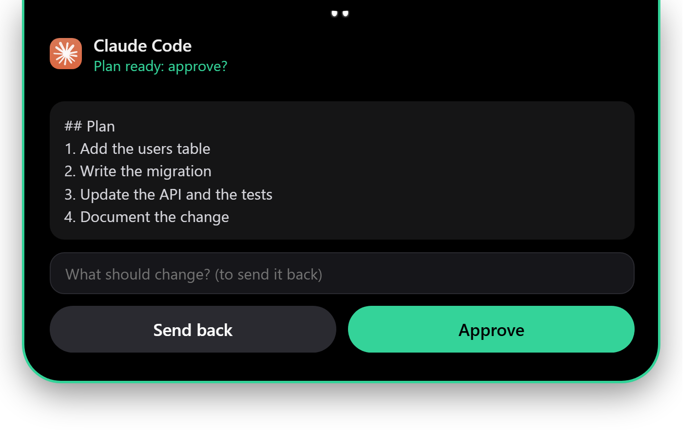

### رد على Claude من الجزيرة

لما Claude يخلص ويسألك سؤال أو يستنى كلامك، فيه خانة تكتب فيها ردك وتبعته، ويوصل لـ Claude كأنك كتبته في التيرمنال.

  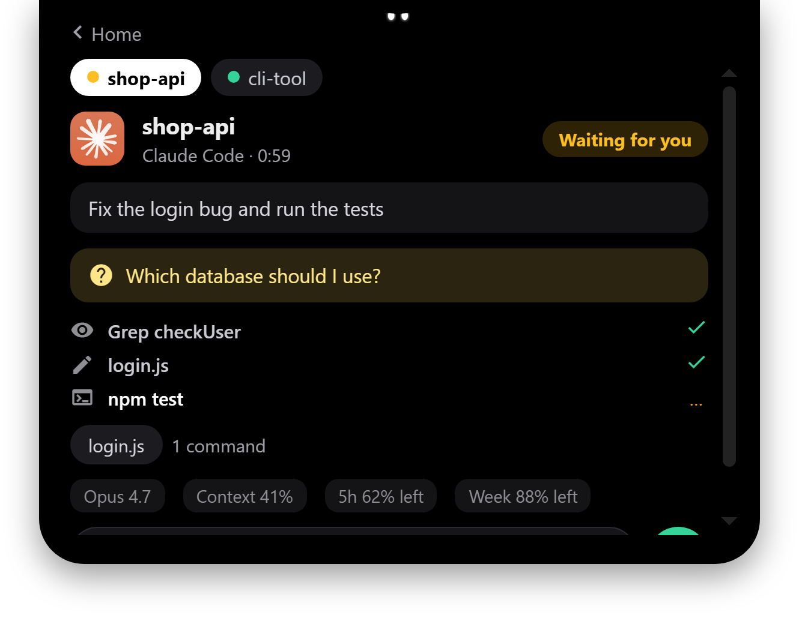
  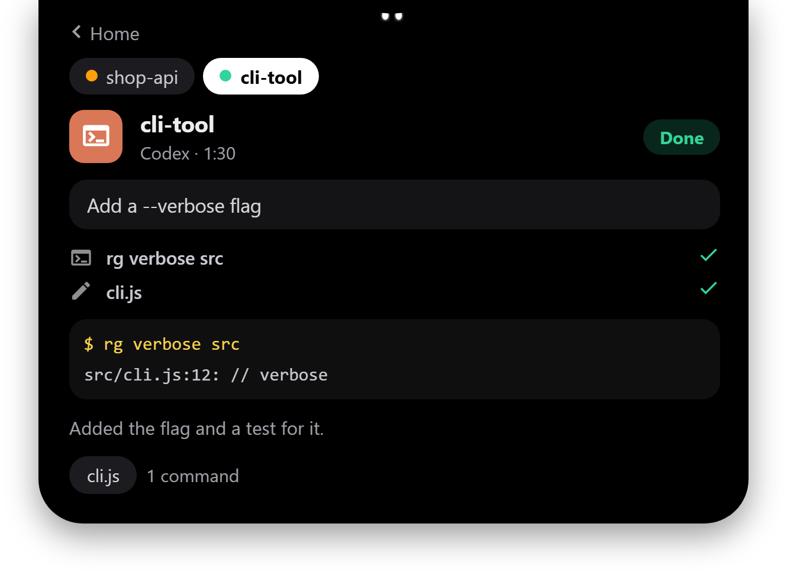

> ده شغّال بـ hook صغير بيستنى في الخلفية بعد كل رد من Claude Code (لحد 30 دقيقة). لو مش عايزه، طفيه من **Settings ← AI & Robo ← Answer Claude from the island**.

### Codex

Codex دلوقتي بيبعت لنوتش شغله كله (الخطوات والأذونات ونهاية كل دور) عن طريق hooks كاملة في `~/.codex/hooks.json`، وبيظهر في نفس الكارد. أذونات Codex بتتجاوب في نافذة Codex نفسها.

### Antigravity

**Antigravity** من Google بقى بيتراقب زي Claude Code وCodex: الجلسة والخطوات (قراية، تعديل، أمر...) ونهاية كل دور، ومعاه إشعار "Antigravity finished". فعّله من **Settings ← AI & Robo**.

  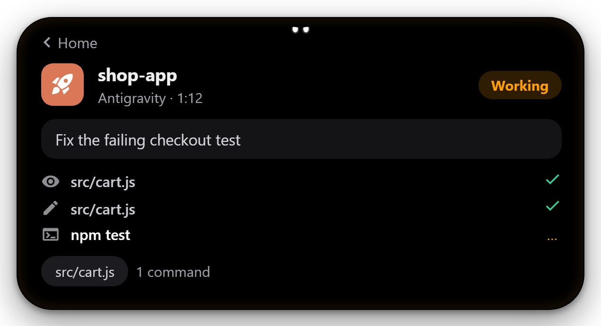
  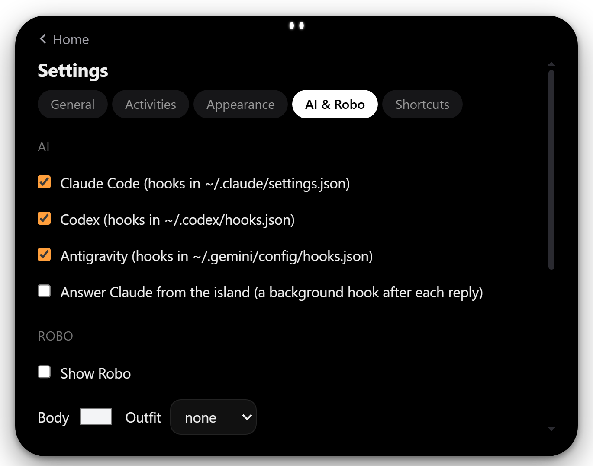

- نوتش بيضيف hook بتاعه في `~/.gemini/config/hooks.json` (الملف اللي بيقراه Antigravity بكل نسخه: التطبيق والـ IDE وسطر الأوامر). **مفيش hook من بتاعك بيتلمس**، وبياخد نسخة احتياطية قبل أي تعديل، ولو الملف مش JSON سليم مبيلمسوش خالص.
- زي Codex، **الموافقات بتتجاوب في نافذة Antigravity نفسها**.
- Antigravity مبيبعتش نتيجة الأدوات ولا آخر رد، فنهاية الدور بتقول "Finished" من غير ملخص.
- الميزة دي لسه جديدة: اتجرّبت بأحداث مصنوعة، فلو شفت حاجة غلط مع Antigravity الحقيقي قولنا.

---

## حلقة استخدام Claude (الـ 5 ساعات)

لما Claude بيشتغل، حلقة صغيرة جنب العينين بتورّيك حدّ الـ 5 ساعات بتاعك (الأرقام الحقيقية من Claude Code نفسه). لونها أخضر، وبتبقى أصفر لما يفضل 30% أو أقل، وأحمر لما يفضل 10%.

اختار الشكل اللي يريحك من **Settings ← AI & Robo ← 5-hour usage ring**:

- **بتنقص كل ما أستخدم** (الافتراضي): الحلقة بتبدأ كاملة وتفضى لما الليمت يخلص.
- **بتتملي كل ما أستخدم**: بتبدأ فاضية وتتملي لما الليمت يخلص.

  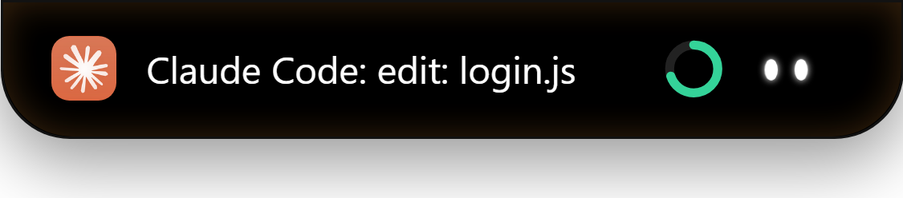
  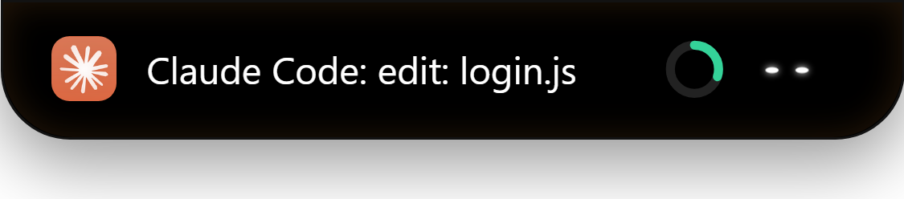

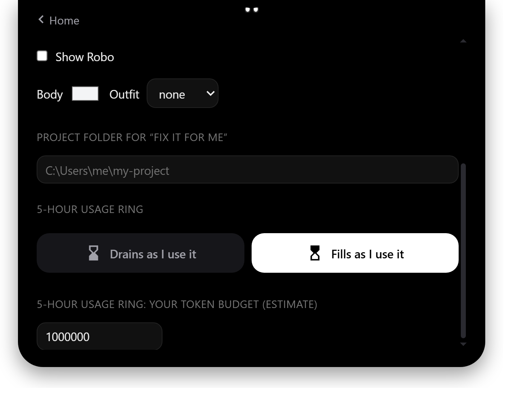

---

## لما المايك أو الكاميرا تشتغل

إشعار سريع (ثانيتين) بلون المايك (برتقالي) أو الكاميرا (أخضر)، وبعدها نقطة ثابتة بنفس اللون — جنب العينين لو مفيش حاجة تانية شغالة، أو جوه حلقة الاستخدام لو فيه حاجة شغالة فعلاً.

  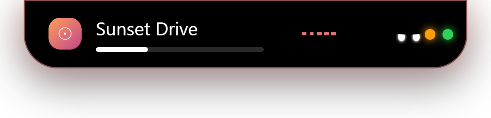
  

---

## بطارية بتتشحن، وتنبيه لما تخلص عملية

تنبيهات البطارية بقت كبسولة كبيرة: الكلام على الشمال (النسبة وإيه المطلوب) وكبسولة فيها بطارية على اليمين:

- **أحمر** لما البطارية تقل (20% و10%): الكبسولة بتنبض والشريط الأحمر بيرمش، وأسرع في الحالة الحرجة.
- **أخضر** لما توصّل الشاحن: شريط الشحن بيتملي ويكرر.
- **أخضر** لما البطارية تكمل: الشريط يتملي للآخر ولمعة بتعدّي على الكبسولة.

  
  
  

وفيه كمان احتفال صغير (كونفيتي) وصوت مميز لما عملية طويلة تخلص.

  
  

---

## كليك يمين = خط رفيع

عايز الجزيرة تختفي من غير ما تقفلها؟ كليك يمين عليها وتتحول لخط رفيع تحت أعلى الشاشة، وأي حركة ماوس فوقه بترجّعها زي ما كانت.

---

## زجاج شفاف

من **Settings ← Appearance ← Glass**: الـ pill والجزيرة المفتوحة بيتحوّلوا لزجاج شفاف زي زجاج Apple، وفيه شريط **Transparency** من "Solid" لحد "Clear".

  
  

- لو الخلفية اللي ورا الجزيرة فاتحة جدًا، الزجاج **بيغمّق نفسه** علشان الكلام يفضل مقروء (جرّبنا كل الشاشات فوق خلفية بيضا).
- بياخد صورة صغيرة للشاشة اللي ورا الجزيرة وهي مقفولة، ويعمل عليها blur. **الصورة بتفضل في الذاكرة بس**: مبتتحفظش ومبتتبعتش.
- الزجاج مقفول افتراضيًا، فشغّله من نفس الإعدادات.

---

## بانرات لغة الكيبورد وCaps Lock

لما تغيّر لغة الكيبورد (Alt+Shift) بيظهر بانر باسم اللغة وكودها (EN / AR)، ولما تدوس Caps Lock بيظهر بانر ليه أنيميشن خاص: لما يشتغل الأيقونة بتنط وحلقات كهرمانية بتتوسّع، ولما يتقفل الأيقونة بتنزل والجزيرة بتهدى. كلهم من غير صوت، وكل واحد ليه مفتاح تطفيه من **Settings ← Activities**.

  
  
  

---

## إعدادات شاملة

تحكم كامل في شكل الجزيرة، الأصوات، اللغة، وتفعيل/تعطيل أي نشاط (تنبيهات الـ CPU والـ RAM، نقطة المايك/الكاميرا، سجل الحافظة، التنزيلات...) حسب ما يريحك.

  
  

### اللغة العربية بالكامل

غيّر اللغة من الإعدادات، والواجهة كلها بتتحول RTL فورًا بخط **Teshrin**.

  
  

---

## إضافة المتصفح

تقدر تثبّت إضافة Chrome/Edge من جوه نفس التطبيق (Settings ← General ← Install the browser extension)، بتخلي نوتش يعرف لما ChatGPT أو Claude أو Gemini أو NotebookLM يخلصوا الرد، وتجيب احتفال خاص بيهم.

---

## اختصارات لوحة المفاتيح (تقدر تغيّرها)

من **Settings ← Shortcuts**: دوس على أي اختصار وبعدين دوس المفاتيح الجديدة. `Esc` بيلغي، و`Delete` بيطفي الاختصار، وزرار Reset بيرجّع كل حاجة. البرنامج بيرفض الاختصار المتكرر، وبيقولك لو برنامج تاني واخد نفس المفاتيح.

| الاختصار الافتراضي | الوظيفة |
|---|---|
| `Ctrl+Alt+T` | فتح / قفل الجزيرة |
| `Ctrl+Alt+H` | الرئيسية |
| `Ctrl+Alt+O` | نسخ النص من الشاشة (OCR) |
| `Ctrl+Alt+Shift+Y` | الترجمة |
| `Ctrl+Alt+Shift+1` | الإشعارات |
| `Ctrl+Alt+Shift+2` | الموسيقى |
| `Ctrl+Alt+Shift+3` | المؤقت وساعة الإيقاف |
| `Ctrl+Alt+Shift+4` | AI Agent |
| `Ctrl+Alt+Shift+5` | الرف |

> الصفحات كانت على `Ctrl+Alt+1..4`. على كيبوردات كتير (إسباني، فرنسي، ألماني...) ويندوز بيبعت `Ctrl+Alt` لزرار AltGr، فكتابة حرف زي `@` كانت بتفتح صفحة من الجزيرة بالغلط. عشان كده نقلناها لـ `Ctrl+Alt+Shift`.

---

## التحديث التلقائي

نوتش بيدوّر على نسخة جديدة وقت ما يفتح، وكل 20 دقيقة تقريبًا، وأول ما الجهاز يصحى من النوم أو يتفتح من القفل (فلو الجهاز كان مقفول وقت ما النسخة نزلت، هتتركّب أول ما ترجعله). النسخة بتتنزّل وبتتأكد من توقيعها الرقمي، وبعد ثواني بتتركّب لوحدها وبيفتح من جديد، **إلا لو فيه سؤال من agent مستنيك** (مش هيقفل عليك وانت بتجاوب). التحديث بيستبدل ملفات التطبيق بس، فهو صغير وسريع. وفي الأول بيظهر كونفيتي صغير يقولك "Updated" ورقم النسخة.

---

## الخصوصية

نوتش بيشتغل على جهازك — بيانات الواي فاي والبلوتوث والموسيقى والإشعارات وشغل الـ agents والملفات اللي بتحوّلها بتتقرا وبتتعالج محليًا ومتتبعتش لأي سيرفر. **الاتصالات بالإنترنت اللي بيعملها نوتش:**

- **التحديثات** ومكتبتي المحوّل (HEIC وPDF) من صفحة Releases هنا لما تحتاجهم.
- **الكلمات** (لو شغّالة): اسم الأغنية والفنان بس، لـ [lrclib.net](https://lrclib.net).
- **الترجمة** (لما تستخدمها): النص اللي بتترجمه، لخدمة ترجمة جوجل (أو MyMemory لو مش شغّالة).
- **غلاف أنغامي** (لو الربط شغّال): بيتنزّل من سيرفر الصور العام بتاع أنغامي.

الباقي كله محلي: زجاج الجزيرة بيعمل صورة للشاشة في الذاكرة بس ومبتتحفظش ولا تتبعت، وقارئ النصوص (OCR) بيشتغل من غير إنترنت، وربط أنغامي ربط على جهازك بس. إضافة المتصفح بتتكلم بس مع نوتش على نفس الجهاز، من خلال توكن سري يتولّد تلقائيًا لكل جهاز.

---

## متطلبات التشغيل

ويندوز 10 أو 11 (64-bit).
